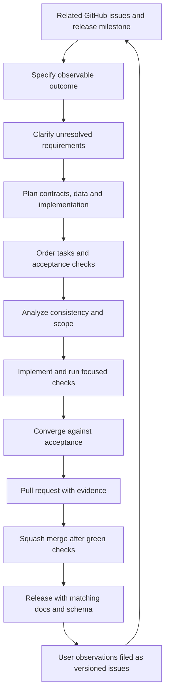

# Development workflow

Optional worker profiles use complete platform wheel hashes and isolated CPython/uv acquisition. Deterministic CI checks exercise their contracts without inference; elected CPU runs validate actual libraries and models separately. The maintainer acoustic harness reads the same builtin model manifests as the product. See [local processing setup](processing-setup.md).

## Tracking and scope

GitHub Issues are the primary work intake, milestones define release outcomes and a GitHub Project provides status. Issues state concrete acceptance, affected versions for defects, dependencies and scope exclusions. The board tracks issues and pull requests without duplicating task text. Use statuses Backlog, Ready, In progress, In review and Done, with Slice, Release, Priority and Area fields.

[Delivery outcomes](roadmap.md) describe product dependencies. Numbered implementation plans and verification records live under `specs/`; public documentation describes system contracts and does not render those planning artifacts.

## Spec Kit slices

Spec Kit organizes bounded, observable work. Python 3.11 or newer supports its cross-platform maintainer helpers. The application runtime uses the language and dependency boundaries defined in [technology decisions](technology.md).

A slice has `spec.md`, `plan.md` and `tasks.md`, with research, data-model, contracts and checklists where useful. Small work stays small; empty artifacts are unnecessary. Resolve critical consistency findings before implementation. Keep each branch and pull request focused on a coherent outcome. Dates and internal progress entries are chronological.

Resolve routine implementation choices against approved product requirements. Clarify unresolved decisions that materially change behavior.

## Building the workspace runtime

1. Use Go 1.27.1, as pinned in `go.mod`, and Node 22 or newer for documentation.
2. Run `go test ./...` and `go vet ./...`.
3. Build the CLI with `go build -o build/insonic ./cmd/insonic` (use `build/insonic.exe` on Windows).
4. Run the built executable with `workspace init <directory> --json`.
5. Select it with `--workspace <directory> workspace show --json` or discover it by running inside that workspace.

Workspace initialization validates the packaged JSON contract and cannot replace an existing workspace. Clients share a current-user local runtime; it starts on demand and exits after idle time. `jobs start <milliseconds>`, `jobs show <job-id>`, `jobs history <job-id>`, `jobs cancel <job-id>` and `jobs retry <job-id>` exercise a bounded durable qualification operation. Jobs and attempts survive owner restarts. Interrupted or expired attempts resume through fresh fenced claims; cancelled jobs remain cancelled until explicit retry. `doctor --json` reports the available catalog and configured storage/graph profiles without returning credential values or switching backends.

The desktop uses a statically bundled React/TypeScript client and packages local documentation. Run `npm ci --prefix desktop/frontend`, then its `check`, `test` and `build` scripts before native desktop qualification. Library, Jobs, Pipelines, Speakers, Terms, Models, Explore and Settings controls use the shared runtime operations. Native qualification pins exact dependencies, verifies artifact checksums and executes bounded platform/backend fixtures. Artifact availability on an architecture does not establish executed package support.

After native dependency preparation and matching documentation/frontend builds, `python scripts/package-desktop.py all --variant both` builds and qualifies CLI-only and GUI-with-CLI packages. `--variant cli` or `--variant desktop` selects one variant. Source-complete media companions retain verified source archives, build recipes, compiler identity and capability receipts. Portable artifact backups use the offline maintenance commands described in [storage](storage.md); they do not start processing workers. [Release tooling](releases.md) binds the complete four-package matrix and documentation to one reviewed clean source revision.

For durable media/model work, `insonic work wait WORK_ID --timeout-ms 30000 --json` waits through runtime IPC in one client process. The default timeout is 30 seconds and the maximum is ten minutes. It returns the observed terminal state; failed, cancelled, interrupted or timed-out waits exit nonzero and retain the last observed state. A wait timeout does not cancel the job.

Managed artifact commands share this runtime: publish/show/verify/materialize/reconcile/abort/retire, retention reference admission/release, materialization lease renewal/release and expired cache pruning. Their exact usage, default bounds and recovery behavior are defined in [storage](storage.md). They operate on real bytes through filesystem/S3 adapters, including library import/metadata, downloaded models and current recording derivatives. Dedicated desktop storage controls remain pending, while the shared bridge accepts the versioned runtime operations.

Owner locks use the private per-user runtime directory and canonical workspace root, so read-only metadata and control-directory edits preserve one owner. A runtime admits up to 1,024 active qualification workers. Terminal history remains in the selected catalog and cannot consume active-worker capacity. Runtime shutdown records interruption rather than user cancellation. Five-second attempt leases renew every second; recovery claims only expired or explicitly interrupted authority, preserving prior attempts.

## Automated checks and user observations

Before merging, run checks relevant to changed behavior, dependency/artifact integrity and reproducible builds. Secret redaction, archive extraction, job attempt ownership and graph publication require meaningful tests. Reversible text changes need formatting and link checks.

Users ordinarily verify released behavior and report observations through issues. A report includes version, platform, expected/actual behavior and a minimal reproduction. Correlate symptoms before asserting a cause. A green unrelated unit suite does not resolve a reported field observation.

## CI budget

Repository CI has parallel integrity, documentation, native-platform and alternative-backend jobs. Native checks run on Linux and Windows, including real dependency operations and the desktop bridge. Backend fixtures exercise PostgreSQL, S3-compatible storage and ArcadeDB. Foundation and documentation checks always run. A change classifier keeps stable platform check names while skipping expensive native work for prose-only changes. Runtime/catalog/schema changes run core and native acceptance plus PostgreSQL catalog fixtures; unknown paths and unavailable diffs receive full qualification. Declared Go, Wails and Ladybug binding pins must match qualification metadata. The maintained Windows WebView binding closes its controller during owned-window destruction, releases its retained COM interfaces and balances its owning COM apartment on normal exit. Its owned UI-thread system-key route preserves the original Alt/scan context before framework forwarding and keeps a claimed accelerator handled. Native menu work is posted after the synchronous callback; unrelated accelerators retain their existing handler. Repository checks verify its upstream and patched source checksums and exact patch scope. Its local lifetime regression uses an unshown message-only window, while actual browser qualification runs on disposable CI. Package qualification compares each variant's notice inventory with its linked Go executable modules and rejects missing or mismatched licenses and patch notices. Documentation checks include KaTeX option handling and hidden headless rendering of public/offline diagrams through both themes. Each CI and release job has an eleven-minute timeout. Cache dependencies, cancel obsolete branch runs and consume committed assets and lockfiles. Network brand freshness checks are manually triggered.

Measure source prerequisite preparation, qualification and combined elapsed turnaround separately. Exact cache verification or the cold source pipeline must finish at an explicit readiness boundary before elected qualification starts, including foundation and documentation checks. Qualification must finish within eleven minutes (660 seconds); queue time within each phase is included. Report initial request-to-attempt queue time separately when available. The aggregate reserves fifteen seconds for finalization and rejects work already past its budget. Final terminal job timestamps and the conservative workflow metadata envelope remain authoritative, including post-job cleanup; a provisional aggregate receipt is not final timing evidence. When qualification approaches its budget, remove redundant work, tighten change scopes or parallelize independent checks. Native jobs build and qualify relocated desktop packages for their executed OS/architecture. CI retains inventories, checksums and receipts; public binary promotion belongs to release delivery. No CI suite, native/backend qualification or required check invokes transcription/diarization, initializes or loads their models, downloads model weights or requires engine results, including cached or small models. Deterministic stage results exercise orchestration and document/storage contracts; bounded real-media probing/extraction, preview encoding and exact Cueson operations are allowed.

## Explicit maintainer engine qualification

Committed CC BY 3.0 speech audio and a short dialogue video are ordinary Git files under `tests/fixtures/media/`, with license/attribution, source/rendition/crop provenance, hashes, measured streams and separately declared reference expectations. Clean checkout and CI use these bytes without Git LFS or test-time media downloads. Supplied subtitles and constructed speaker turns qualify document/timing behavior, not model quality.

Actual recognition and diarization testing runs only through the explicit opt-in maintainer path. It is outside CI and merge requirements. Select installed local Python environments and registered exact managed models, record settings/device/thread/time/output bounds, and retain measured resource and quality diagnostics. No worker silently downloads weights or routes to another provider/device. A reference-text oracle cannot be supplied as alleged generated recognition output.

`insonic processing tools CONFIGURATION.json` validates the registered `processing-tools` contract before publishing workspace configuration. Selected executables and the worker require absolute paths and lowercase SHA-256 identities; decoder configuration also requires its exact version. Positive duration, input/output, wall-time and thread limits are checked independently of inference. Omitted inference tools remain valid for supplied-subtitle assembly and export, and explicit readiness checks import libraries without loading models. Actual inference is qualified when its operation runs. CPU is the default; selected CUDA failure never silently switches devices.

Local inference, processing decoders and Cueson receive an explicit execution environment rather than the runtime's application/provider credentials. Preserve `PATH`, `SystemRoot`, `WINDIR`, `TEMP`, `TMP`, `TMPDIR`, `LANG` and `LC_ALL` with Windows case-insensitive selection. Preserve `LD_LIBRARY_PATH` on Linux, `CUDA_PATH` on Windows, and `CUDA_VISIBLE_DEVICES` on Linux/Windows. Inference workers receive explicit offline flags and a disposable private empty `HOME`/`USERPROFILE` for libraries that require home-directory discovery. The operator's home, application configuration and model-provider credentials are not inherited. Remove that private home after success, failure or cancellation.

Report recognition/timing agreement, speaker-count/coverage/overlap diagnostics and their reference basis separately from schema/document validity. Published subtitle display windows and editorial character labels are not sample-accurate voice activity or biometric identity truth. Distinguish measured engine behavior, deterministic regressions and unverified platforms in the qualification receipt.

Saved pipeline, speaker and terminology qualification uses deterministic local adapter results and bounded loopback hosted-worker fixtures. Protocol tests exercise actual HTTP request shape, mapping, credentials, redaction, redirects, response limits and cancellation without contacting external services. Required checks never call recognition or diarization models, download weights or use live provider inference. CLI and desktop bridge tests share the runtime contracts and explicit revision inputs.

## Documentation and contract governance

Public documentation states the authoritative system behavior. Keep slice identifiers, task records and verification evidence in internal planning. Historical and version-change descriptions belong in the [changelog](changelog.md). The documentation index carries the concise implementation-status statement.

Use numbered steps for a procedure with one linear path. Use a diagram when branches, relationships, dependencies, feedback or retry paths explain the system more clearly. Keep Mermaid flowcharts top-down with `TB` or `TD` orientation.

The software, documentation and master JSON Schema share one release version. The [JSON contracts](contracts.md) define machine-readable boundaries; the [logical catalog schema](schema.md) defines relationships and integrity. Prefer backward and forward compatibility where practical. Explain breaking changes in the changelog and concise release highlights, including the migration or affected interface.

For every major release, rescan all documentation for technical terms and refresh the [glossary](glossary.md). Each entry explains the exact term, links a primary external learning reference and points to the local pages that use it most heavily.

## GitHub setup and merging

The maintainer bootstrap configures Issues, squash-only merges, automatic merged-branch deletion, labels, milestones and a Project. The bootstrap declares `foundation`, `docs` and the always-running `elected acceptance` aggregate as required checks, alongside resolved conversations. The aggregate requires every elected scope, package producer and candidate result to succeed, rejects cancellation and unexpected skips, and explicitly records legitimate non-election. Apply and verify protection after the published checks exist.

`npm run github:check` reads setup status. `npm run github:apply` applies prepared settings to an existing repository with repository-administration and organization-Project permissions. It does not create or push a repository. Repeated setup reuses tracked issues, milestones and the Project, preserving edits, existing values and archived work. Initial status setup applies only to a new empty Project. Missing required status options or established-item metadata are reported for completion. After a partial failure, resolve permissions, rerun and confirm settings and membership through API readback.

Squash merges follow green required checks and resolved review findings. Human PR approval, code-owner approval and last-push approval are not mandatory. The bootstrap preserves zero required approvals; automated analysis and focused checks remain part of development. Agents follow the owner's authorization for the merge itself.

See [contribution guidance](../../CONTRIBUTING.md) and [release workflow](releases.md).

Windows native preparation installs its pinned archive decoder with `python -m pip install --target build/native/python zstandard==0.25.0`. The prepared graph loader uses checksum-pinned OpenSSL ABI-3 companions, and relocated packages include their exact DLLs and Apache 2.0 notice beside the executables. No ambient OpenSSL PATH is required.

## Extracted-package connected qualification

Both package variants include `companions/processing/processing-worker.py` in their verified inventory. An elected maintainer journey uses `python scripts/qualify-journey.py --package ARCHIVE --package-receipt RECEIPT --revision FULL_COMMIT --mode controlled|real --recognition-python EXECUTABLE --diarization-python EXECUTABLE --output RECEIPT`. Real mode additionally requires exact installed `--recognition-model` and `--diarization-model` snapshots. This qualification runs outside CI in owned disposable workspaces and a private home; it does not use an operator library.

Package selection verifies archive/inventory/source receipts, clean elected revision, current versions and platform, then extracts into a directory containing spaces. CLI, media tools, Cueson and the real worker resolve only inside that installation. Development CLI/tool overrides are rejected, and ambient native loaders, tool overrides and credentials are removed from child execution. Python environments and offline models remain explicit inputs. Controlled mode records its synthetic fixture worker separately from the installed real worker.

The connected journey covers generated current transcripts and source maps, speaker enrollment/profile selection, roster-constrained matching, native queries, self-contained backup, source withdrawal and exact current-authority recovery in an empty destination. Receipts distinguish package source identity from the maintainer harness and identify exact inputs. Successful connected operations establish execution and recovery for those fixtures; they do not establish independent biometric accuracy, attended GUI behavior or unexecuted platform inference.

## Documentation reuse in qualification

Scope classification elects preparation before the qualification phase. Only known presentation and documentation changes skip native qualification; unknown, mixed, dependency, schema, runtime, packaging and workflow changes elect the complete checks. Source compilation can begin after scope selection, but runtime, package and adapter consumers still require successful foundation checks.

The documentation producer builds one exact-source public/offline export and binds both archives to source, version, workflow run and attempt with size/SHA256 identities. Documentation browser qualification and native consumers restore that same export from a digest-checked artifact. Missing, redirected, stale or mismatching transfers fail without a local rebuild fallback. Native jobs retain dependency installations for notices and all desktop, relocation, CLI, installer and artifact checks. Release qualification independently builds its documentation unless the CI-specific reuse input is explicitly enabled. Windows package consumers start only after verified source, foundation and documentation producers succeed. Verified warm and cold preparation paths have an explicit terminal handoff; failed or cancelled preparation cannot start consumers. Exact caches accelerate preparation, while missing, evicted or invalid inputs follow cold preparation without widening restore keys or transfer deadlines. Same-run/attempt artifact digests, recipe/compiler/source checks and receipt rehashing remain required. Source jobs retain resolved package inventories as observations, separately from the existing compiler identity; this does not claim a fully pinned compiler/linker/runtime environment. Candidate aggregation waits for foundation, documentation browser qualification, source producer success and both platform package results. Restricted-session capture initialization may retry once in fresh owned workers after its exact startup timeout; assertion failures and a repeated timeout remain failures. Worker and job deadlines are unchanged.

An explicit site_smoke maintenance dispatch runs foundation, documentation and the read-only live-site job without duplicate native package builds. Ordinary dispatches and unavailable PR/push diffs still select full qualification. Main publication accepts only the exact completed push/main run, so a maintenance smoke cannot substitute for product qualification.

## Versioned screenshot provenance

Documentation screenshots describe their recorded clean capture revision and version. Image bytes, dimensions, accessible captions and source hashes remain checked. If current source has moved, the builder verifies every recorded source hash and the captured VERSION against immutable Git blobs from that exact ancestor of the current checkout. It uses one bounded batch per receipt and executes no historical code. A missing or foreign revision, mismatching hash or wrong captured version fails the build. Fetch complete history when building changed source with frozen captures. Capture receipts and PNGs are not rewritten to claim that an older image came from newer source. Current application UI capture qualification still runs separately in native CI, using the current source and an isolated headless browser.

The current source implementation gives native query and explain RPCs a 25-second aggregate budget covering current graph publication and execution. The engine retains its twenty-second query ceiling, bounded by the remaining RPC time. An earlier caller deadline or cancellation ends the client wait. Transport timeouts are cancellation conditions, not evidence of malformed query input. Immutable release binaries retain their tagged implementation.

After a transient artifact-service failure, rerun complete qualification so all producers and consumers use one current workflow attempt. Isolated consumer reruns cannot substitute artifacts from an older attempt.

## Desktop control and Exit qualification

The Wails host applies consumer-owned composition using the delivered interface, spacing and typography tokens. The governed kit remains byte-for-byte upstream. The checkbox glyph uses native appearance at the body token size; its associated compound label retains the minimum interaction target. Ordinary actions size to their content. No undocumented density component property or preference is required.

Application capture observes Setup, Library, Jobs, Pipelines, Models and Settings at 1200 by 800 and 720 by 600, with renderer scales 1, 1.25, 1.5 and 2 and normal or 200% text. Its separate density receipt records all 96 observations and seven representative images. The regular setup receipt retains its four original landmarks. Native journey checks additionally observe actual processing controls after opening an imported recording.

Source and extracted-package native Exit qualification activate the owned Windows keyboard menu path or GTK menu item, then require normal GUI process termination. A separate fixture owner hosts the real runtime and a held synthetic model acquisition. Direct IPC must report the same runtime session and durable work identity after each GUI exits, with playback handles and the loopback listener released. Releasing the byte barrier must let the acquisition finish. Ordinary close is checked alongside Exit; Windows also checks Alt+F4 through native input, requiring the fixture window to be owned, visible, enabled and foreground before delivering the chord. Only the fixture owner cancels its own runtime context after completion. Windows menu qualification also requires the actual native system-key route, then real X input and the Exit callback. No callback or forced-process fallback can produce a successful Exit receipt.

Desktop CI cache keys include the root, frontend and documentation dependency locks. Candidate collection can use `--summary` for concise completion metadata and the full manifest digest in logs; the complete verified manifest, asset checksums and package inventories remain in the candidate artifact. The default maintainer command output remains unchanged.

Native Exit failure diagnostics retain separate bounded standard-output and standard-error streams, the last startup/action checkpoint, actual child exit status and deadline/truncation classification. Successful machine-readable receipts remain separate. Explicit manual incident replay verifies the selected historical package and records diagnostic-tool identity separately; derived source probes and failure observations cannot replace complete package qualification or authorize publication. A failed Windows proof producer retains its exact run/attempt/source and scope before the join rejects it, so secondary missing completed receipts do not obscure the primary failure. A successful diagnostic replay does not establish the cause of an intermittent startup failure.

The disposable Windows archive CI lane allocates its launched CLI workload to three of the configured four CPUs while GUI qualification runs concurrently. This covers the installed PowerShell first-use journey, main CLI commands and contract media/example helpers, including inherited detached-runtime affinity. Each explicit root receives and verifies its mask before execution; fixed receipts distinguish those verified roots from inherited descendants. The shared parent and GUI jobs retain their existing affinity. Unsupported topology or allocation failure stops qualification before launching the workload. Commands, parallelism, all twelve cold/warm Exit cases, native input, natural-release checks and deadlines remain required. This allocation excludes one CPU from the launched CLI workload; other system activity can still use it. The receipts describe CI execution and do not establish installed-desktop behavior.

The private native wait-query helper accepts its bounded request only over an inherited input pipe created by a live parent running the same executable file. The operating system supplies the pipe creator identity, and the parent retains the existing owned-window target selection. Direct invocations with another caller, a copied executable or an unverified channel fail before a wait query. Parent identity remains live through the query, and the existing observation deadline and content-free output bounds remain required.
