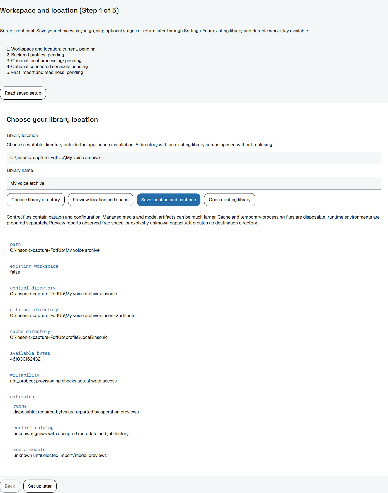
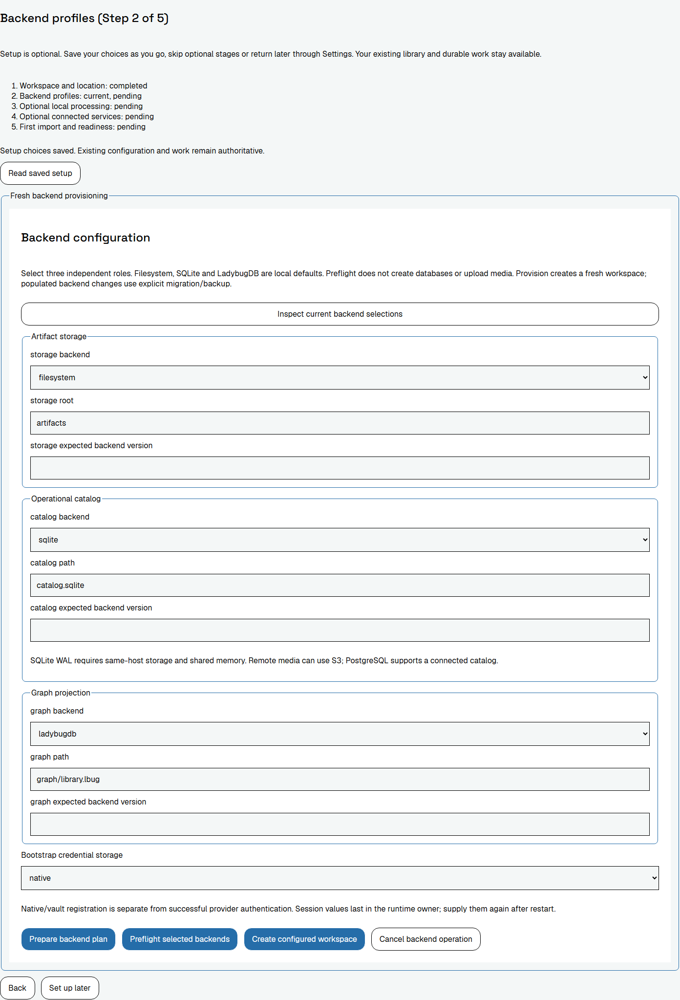
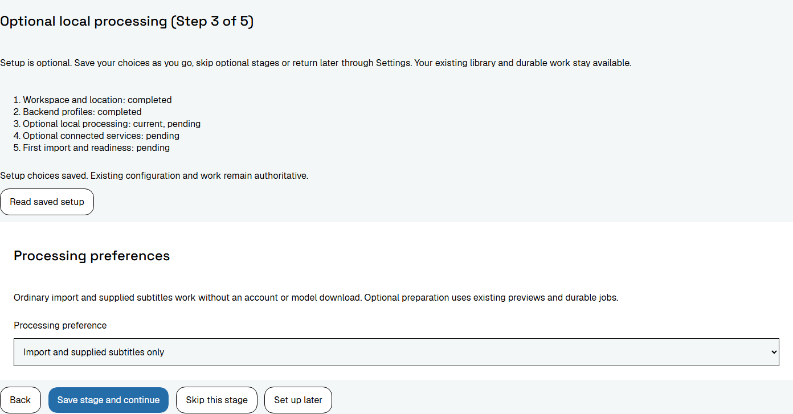
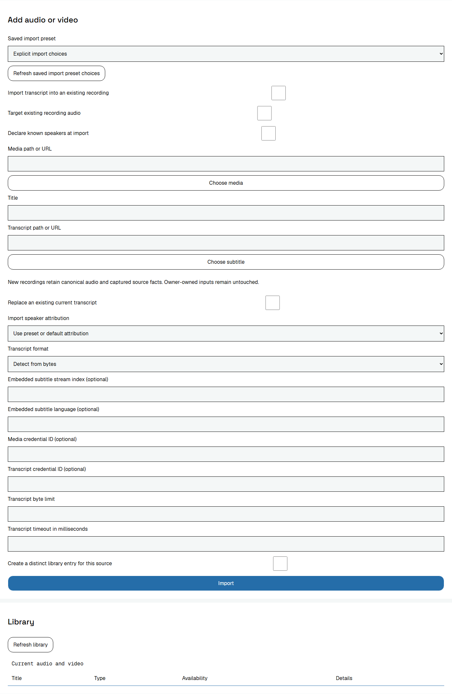

# Windows installation, updates and removal

Use the official release's Windows x86-64 package. The MSI offers Desktop application, CLI or both; both are selected by default. The ZIP packages remain available for portable copying. amd64 means x86-64, including compatible Intel and AMD processors. The [version index](index.md) states whether official downloads are available.

The Windows MSI and application are initially unsigned, with no verified publisher signature. A checksum identifies matching bytes; it does not add a signature or establish Windows reputation. Download, application reputation, permission approval, license acceptance and missing dependencies are separate checks.

## Install normally

1. Open the [official releases](https://github.com/shruggietech/insonic/releases), choose the exact version and download its `insonic_VERSION_windows_amd64_installer.msi`. Replace VERSION with that release's version. Keep its `SHA256SUMS` and `release-manifest.json` links for identity checks. If a warning appears, follow the matching branch below.
2. Install the [applicable prerequisites](#prerequisites), then open the downloaded MSI. The MSI installs for the current user; it does not install for all accounts, acquire prerequisites over the network or add directories to PATH.
3. Read the actual Apache License 2.0 and select **I accept the Apache License 2.0**, which starts unchecked. Acceptance is required to continue.
4. Choose Desktop application, CLI or both. Desktop-only retains the shared runtime and command executable required by the application, while omitting exposed CLI launch integrations. CLI-only omits the desktop application and its WebView2 requirement. At least one client is required.
5. Keep the per-user program location under `%LOCALAPPDATA%\Programs\insonic`, or browse to a suitable writable program directory. Keep libraries, recordings, models and settings outside it. Spaces and non-ASCII names are supported. No user data is stored in installer-owned program files.
6. Choose the optional desktop icon and Start menu integrations. The Start menu folder is **insonic**; the application shortcut is **insonic** and the command shortcut is **insonic CLI**. The desktop shortcut is **insonic**. Integrations follow the selected clients.
7. Install, then keep the checked **Launch insonic** option to open the desktop when selected. For CLI-only, **Open insonic CLI** opens a persistent command session with useful help/setup guidance. Clear the option to open the selected client later. Cancellation, failure, unattended installation and maintenance do not launch clients.
8. Use [optional first-run setup](setup.md), open an existing library or choose **Set up later**. Local filesystem/SQLite/LadybugDB defaults need no service account or API key. Installing insonic does not download inference models or elect connected routes.

### Optional checksum comparison

1. Save `SHA256SUMS` beside the downloaded MSI.
2. Open PowerShell in that download folder and replace VERSION below:

   ~~~powershell
   Get-FileHash -Algorithm SHA256 ".\insonic_VERSION_windows_amd64_installer.msi"
   ~~~

3. Compare the complete hexadecimal hash with the line for that exact filename in `SHA256SUMS`. Matching letters can differ in case. If bytes do not match, discard that download and retrieve the official asset again; do not install it.

## Prerequisites

Both clients require the Microsoft Visual C++ v14 x64 runtime. Use [Microsoft's runtime guidance](https://learn.microsoft.com/en-us/cpp/windows/latest-supported-vc-redist?view=msvc-170) and [official x64 installer](https://aka.ms/vc14/vc_redist.x64.exe). Download the complete installer while online for transfer to an offline computer.

Desktop application additionally requires the WebView2 Runtime. Microsoft's [download page](https://developer.microsoft.com/en-us/microsoft-edge/webview2/) and [distribution guidance](https://learn.microsoft.com/en-us/microsoft-edge/webview2/concepts/distribution) distinguish the online Evergreen Bootstrapper from the x64 Evergreen Standalone Installer for offline installation. Microsoft Edge itself does not replace WebView2. CLI-only does not require it.

The MSI explains missing prerequisites. Install the relevant official runtime, honor its restart instructions, then retry the MSI. Prerequisite installers may request administrative approval depending on their chosen mode; the insonic per-user MSI does not request an all-users installation. Removing insonic does not remove shared Microsoft runtimes. Loader errors and unavailable dependencies are not a license or reputation confirmation.

## Download and Windows warnings

### Edge says the download is not commonly downloaded

1. Confirm the download's filename, version and official release address. An unknown/not-common reputation warning differs from a file reported as malicious.
2. For the unknown-file branch in Microsoft Edge, open the download item's **...** menu, then choose **Keep**, **Show More** and **Keep anyway** when offered. This retains the selected download.
3. If the warning reports malware, or device policy removes continuation, record the exact warning and use the [support checklist](#support-checklist). Do not apply unknown-file instructions to a reported-malicious detection.

Microsoft documents these controls and managed-policy differences in [Edge SmartScreen guidance](https://learn.microsoft.com/en-us/deployedge/microsoft-edge-security-smartscreen). Other browsers have different controls; use their matching guidance.

### Windows protected your PC

1. If this application-reputation dialog appears, select **More info**.
2. Check the displayed file matches your selected official download. This unsigned release does not have a verified publisher signature.
3. Select **Run anyway** if that control is available and you intend to run the selected file. If it is absent, use the support checklist; organization policy can prevent continuation.

Microsoft's [first-app guide](https://learn.microsoft.com/en-us/windows/apps/package-and-deploy/publish-first-app) documents those controls, and [SmartScreen reputation guidance](https://learn.microsoft.com/en-us/windows/apps/package-and-deploy/smartscreen-reputation) explains unsigned-file reputation and enterprise blocks. The dialog is conditional; every MSI or extracted application need not show it.

### Permission to change the device

A User Account Control prompt concerns elevation. It is separate from SmartScreen and Apache license acceptance. A prerequisite installer or an administrator-directed change can need permission even though insonic installs per user.

1. Identify the program and requested change. An unsigned program has no verified publisher identity.
2. Choose **Yes** only for the identified change you intend to allow, or **No** to decline it.
3. A standard account may instead need administrator credentials. Ask your administrator rather than entering credentials into the insonic setup guide or an unrelated window.

[Microsoft's UAC documentation](https://learn.microsoft.com/en-us/windows/security/application-security/application-control/user-account-control/how-it-works) distinguishes administrator consent from standard-user credential prompts and explains secure-desktop behavior.

### Smart App Control, S mode or organization policy blocks execution

Smart App Control can reject an unsigned/untrusted file and currently offers no individual-app override. **More info / Run anyway** does not bypass it. Contact the developer or device administrator with the support checklist. Microsoft's [current FAQ](https://support.microsoft.com/en-us/windows/security/threat-malware-protection/smart-app-control-frequently-asked-questions) also explains that recent Windows updates can permit re-enabling Smart App Control without a clean installation; older universal reset claims are not applicable to every device.

Windows S mode permits Microsoft Store applications. Leaving S mode is a one-way device choice, not a normal warning acknowledgment. Read [Microsoft's S mode FAQ](https://support.microsoft.com/en-us/windows/experience/platform-variants/windows-10-and-windows-11-in-s-mode-faq) and consult the device owner or administrator before deciding.

App-source recommendations are another setting. On Windows 11 they appear under **Settings > Apps > Advanced app settings > Choose where to get apps**, with options depending on the device. Microsoft's [app recommendation guidance](https://support.microsoft.com/en-us/windows/apps/change-your-app-recommendation-settings-in-windows) explains those choices. Organization controls may be locked and can prohibit unsigned or outside-store installation. Global antivirus, Defender, SmartScreen and organization-policy disabling are not steps in the normal installation procedure.

## Change, repair, upgrade or remove

1. Finish or explicitly cancel selected work in Jobs or CLI work commands, then close clients from the installation being changed. Closing the desktop does not cancel durable work. Allow the hidden runtime at least 31 seconds of inactivity to exit; new requests reset activity. [Desktop maintenance guidance](desktop.md#close-the-old-installation-before-maintenance) explains how to identify remaining processes.
2. Open **Settings > Apps > Installed apps**, find **insonic**, and use its offered maintenance/removal action. The installer supports feature changes, repair and removal. If active work prevents replacement, close that work and retry; maintenance does not silently terminate it.
3. For an upgrade, download the newer matching MSI and open it. The installer preserves accepted selections; failed replacement rolls back the prior program installation. Older-version installation is rejected. Retain a [library backup](storage.md) because program rollback does not reverse independently accepted library changes.
4. For removal, select **Uninstall** and complete the MSI removal. It removes only owned program files and integrations. Libraries, media, settings, models, credentials, shared Microsoft runtimes and unrelated portable ZIP installations remain.

Per-user configuration uses `%APPDATA%\insonic`; local data/cache/runtime coordination uses `%LOCALAPPDATA%\insonic`. Library data follows the actual elected profiles. Native protected credentials remain in Windows Credential Manager; vault/credential configuration uses the library's private secret area. Preserve these locations during ordinary program removal. See [storage](storage.md), [credentials](secrets.md) and [models](models.md).

## Portable ZIP alternative

1. Choose the exact Windows Desktop + CLI or CLI-only ZIP and install its applicable prerequisites.
2. Extract the complete tree. Keep companions, native libraries, notices, corresponding sources and offline help together.
3. Follow [Windows ZIP installation](desktop.md#install-a-windows-zip) to copy into a stable program directory and choose a separate library.
4. Open `insonic-desktop.exe` when included, or use `insonic.exe` from an already open terminal. ZIP copying creates no MSI registration, Installed Apps entry, shortcut, PATH integration or supplied uninstaller.

## Application walkthrough

These application images are real rendered controls from the compiled frontend using an isolated library and current shared CLI contracts. Their renderer is headless Chromium rather than native WebView2. Browser/viewport/source and image identities are recorded beside the captures. They contain fixture data, not a user's library. Policy-dependent Edge, SmartScreen and UAC prompts are described above; no unobserved OS dialog is presented as a screenshot.

Figure 1. Optional setup previews an editable library location outside program files. Keep the default or enter your chosen separate library directory, preview capacity, then save the location and continue.

Figure 2. Keep local backend defaults or explicitly choose the three storage roles before creating a library. Choose local defaults or complete the elected backend fields. Preflight before provisioning; service credentials remain transient protected inputs.

Figure 3. Optional processing follows successful library creation; import and supplied subtitles need no model download. Elect processing when wanted, or skip it and continue. Application installation alone does not prepare model inference.

Figure 4. Deferring setup leaves the ordinary Library controls available. Use ordinary Import controls without completing optional stages.

## Support checklist

Record Windows edition/build, browser/version, selected package/version, exact warning or error text and available controls. Include whether the failure occurred during download, MSI launch, prerequisite installation, maintenance or application first use. Omit private paths, account identifiers, keys and secrets. [Open a GitHub issue](https://github.com/shruggietech/insonic/issues) with those details and the relevant package identity.
