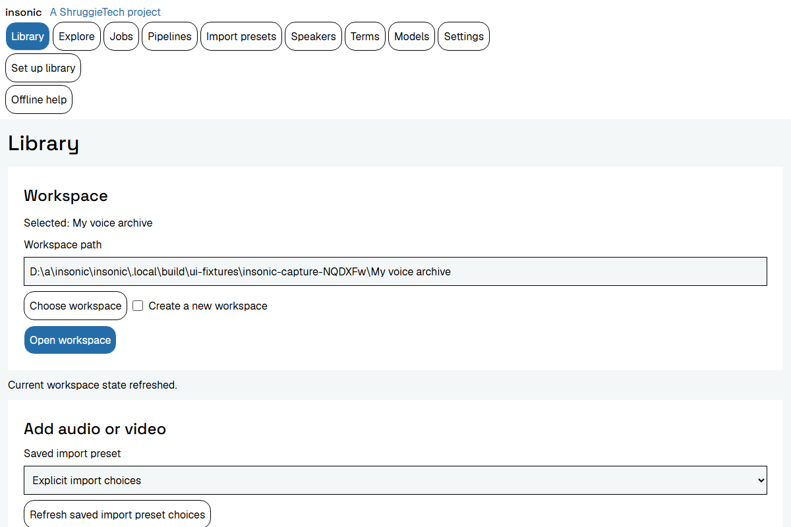
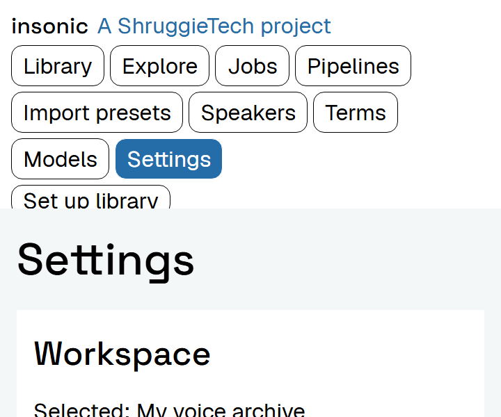

# CLI and desktop experience

Settings provides shared managed CPU setup, existing-environment inspection, exact builtin model preparation, protected token registration and task readiness. A preview precedes durable preparation; Jobs exposes its progress, cancel and retry actions. Manual tools remain under Advanced. See [local processing setup](processing-setup.md) for CLI parity and installation prerequisites.

Optional [first-run setup](setup.md) guides workspace location, backend choice, processing, connected services and first import. Skip stages or choose Set up later without blocking normal commands; reopen from Settings with accepted configuration and work intact.

## Startup failures

Windows browser initialization returns synchronous loader errors and asynchronous environment/controller failures through the same desktop startup reporting path. An existing regular file at the intended browser profile path is reported as a directory error before native initialization. A failed startup skips the ordinary application loop, closes its owned window and partial browser resources on the UI thread after native callbacks return, and leaves a later launch free to use the intended profile. There is no automatic retry or profile deletion.

If workspace selection or the desktop host returns a startup error, a native error dialog shows the bounded underlying cause and a correction to check the indicated dependency or directory access. The same message goes to stderr for launches from a terminal. A returned failure releases the desktop-owned playback transport and menu observers.

The application attempts a private startup event under its per-user configuration directory, in `insonic/diagnostics/desktop-startup.jsonl` (on Windows, %APPDATA%\insonic\diagnostics). Events contain a timestamp, generated startup stage and an available unsigned numeric operating-system error or HRESULT. Native stages distinguish environment creation/completion, controller setup, browser access, bootstrap requests, message-loop interruption and owning-window destruction. They exclude arbitrary error text, paths, arguments and provider output. Each file is bounded to 1 MiB with two predecessors. The dialog reports the saved location or that diagnostics could not be saved; a storage failure never replaces the original cause. Windows uses a current-user protected ACL and Linux uses mode 0600. Explicit unattended qualification writes its controlled receipts without opening failure dialogs or writing ordinary per-user startup logs.

## Shared operations

The application is CLI-first. Every core capability has an automation-ready CLI contract, and the GUI installs the CLI and wraps equivalent shared-runtime operations. Both use the same workspace IDs, job states, pipeline definitions, query parameters and errors. No core behavior lives only in GUI code. Shared capability and release matrices record which client exposes each operation.

Advanced or experimental CLI capabilities may ship before their GUI controls. Each release documents that lag in its capability matrix, including the CLI command, current GUI availability and its follow-up outcome. This exception does not turn mature core operations into permanent CLI-only features. Speaker-model dataset, training, discovery, retrieval, profile selection and matching controls use the same shared operations as the CLI.

CLI groups include `setup`, `workspace`, `media`, `import-presets`, `transcript`, `recordings`, `pipelines`, `work`, `jobs`, `speakers`, `terms`, `search`, `query`, `export`, `models`, `workers`, `processing`, `settings` and `doctor`. Human output is concise; `--json` provides versioned machine-readable records, diagnostics go to stderr, and exit statuses distinguish failure and partial completion. Noninteractive invocations never prompt. Secret entry uses a protected input channel, not command-line values.

The desktop exposes Library, Import presets, Jobs, Pipelines, Speakers, Terms, Models, Explore and Settings screens. The native bridge uses the same workspace/runtime requests and protected credential channel as the CLI. Library details support captured metadata, date corrections, reference relocation, explicit audio replacement and transcript policies, initial/current declared rosters, current recording assembly/processing, inspection, rerun, native export and known-speaker mappings. See [subtitles](subtitles.md), [pipelines](pipelines.md), [credential commands](secrets.md), [downloaded models](models.md) and [import](ingestion.md) for shared validation and executable operations.

| Capability | CLI | Desktop |
| --- | --- | --- |
| Optional first-run location/draft, saved setup progress and task readiness | Shared setup commands and versioned state | Five-stage Setup, skip/defer/resume and Settings reopening |
| Create/open workspace, import/list/inspect media, metadata/date correction and relocation | Implemented | Dedicated Library controls and native dialogs |
| Current Cueson assembly, configured processing, rerun, export and speaker mappings | Implemented | Library detail controls and current cues |
| Saved pipelines and context, speaker identities/aliases/current evidence, terminology | Implemented | Pipelines, Speakers and Terms controls |
| Durable work inspection, cancellation, retry and recovery | Implemented | Jobs controls; window closure preserves work |
| Model register/acquire/list/show/verify/materialize, aliases, discovery and resolution | Shared versioned commands | Models controls, shared reference selectors and advanced source/alias configuration |
| Managed local worker setup/reuse, builtin model preparation and task readiness | Shared workers/models/processing operations | Settings previews, protected model access and durable work controls |
| Media/processing tool configuration and appearance | Shared settings operations | Revision-checked Settings forms |
| Original/preview playback and current cue/span seeking | Shared playback contracts | Native audio/video controls |
| Low-level artifact retention/leases, catalog snapshots, profile migration and detailed raw bundles | Advanced commands | Readable profiles; advanced operations remain in the CLI |
| Text/graph queries, current evidence extraction, calendars, recording timelines, saved definitions/layouts | Implemented | Explore controls, source playback, force graph and accessible tables |
| Optional query assistance | Shared insonic-http/native Ollama adapters and validated current queries | Explore discovery, endpoint/model election, synthetic test, suggestion/edit/run/save and explicit auto-run |
| Speaker-model datasets, elected training, exact retrieval and profile selection | Implemented shared commands | Speakers training and Models discovery/fetch/profile controls |
| Roster-constrained matching of current voices | Matching-only command | Library controls and bounded outcome pages |
| Complete portable backups, reference-only retention and verified empty-target restore | Advanced offline `backup` commands | CLI maintenance availability; dedicated backup controls follow |

The matrix describes the interfaces in this documentation version. Dedicated profile migration controls follow catalog migration/backup delivery; saving an appearance or tool setting does not replace storage/catalog configuration.

Model selectors distinguish registered declarations from verified availability, and show aliases, exact versions and compatibility. Missing compatible selections acquire before elected processing; Jobs exposes acquisition dependencies and failure rather than claiming inference has completed. Models discovers trained outputs by speaker, fetches an exact version and selects or clears its current profile with a displayed revision. Speakers accepts explicit adapter configuration or a saved training profile at an exact revision. Source configuration remains an advanced structured input; it never silently guesses download URLs.

The following examples illustrate the product contracts; consult each capability page for complete input files and current executable command syntax:

```sh
insonic workspace init PATH
insonic media import FILE --copy
insonic media import FILE --copy --originated-at "2024-06-08T14:30:00" --timezone America/New_York
insonic media import FILE --copy --originated-on 2024-06-08
insonic media import --manifest imports.json
insonic transcript import SUBTITLE_FILE --record MEDIA_ID
insonic work list --json
insonic search "sample phrase" --json
insonic models dataset create --input dataset.json
insonic models train --input training.json
insonic models list --speaker SPEAKER_ID
insonic models speaker show MODEL_VERSION_ID
insonic models speaker fetch MODEL_VERSION_ID --destination MODEL_DIRECTORY
```

`--originated-at` accepts a date and time; `--timezone` accepts an IANA zone, UTC or a numeric UTC offset. An unzoned supplied time uses the captured local IANA zone for that import. `--originated-on` records date-only precision and does not invent midnight or an exact instant. CSV and JSON batch manifests carry per-item source paths, date precision, zone and metadata overrides; saved preset values are overridden by manifest defaults, then per-item fields, then explicit CLI flags. The default date precedence is owner-supplied value, valid zoned embedded value, explicitly timezone-interpreted embedded value with its assumption recorded, then unknown. File modification time is never silently treated as origination time. `--date-precedence` accepts `owner-first`, `embedded-first` or `filesystem-fallback`.

Repeated daylight-saving wall times accept an explicit offset or `--dst-fold earlier|later`. Nonexistent wall times require a corrected date or explicit `--dst-gap shift-forward` policy. The media is still admitted with that date observation marked unresolved until disambiguated. Batch jobs continue with unaffected items; work succeeds when every admission succeeds, while `result.partial: true` and per-item date states disclose unresolved observations. Failed admissions make `work wait` return exit 1. Missing or unusable embedded dates never block admission. Media inspection exposes the chosen recording time, precision, zone, source and competing metadata observations so corrections are understandable and reversible. See [import, metadata and dates](ingestion.md).

## First-run experience

1. Open optional Setup and preview the editable library location, or open an existing library. An existing identity and accepted routes are preserved.
2. For a fresh library, choose local defaults or complete backend fields and preflight before provisioning. Filesystem/SQLite/LadybugDB need no account or API key.
3. Elect processing only when wanted. Use shared managed CPU setup or inspect an existing environment, prepare exact selected models and save a pipeline. Preview requirements before accepting work; Jobs retains preparation progress.
4. Discover connected-service metadata and explicitly elect a route when wanted. Protected credential entry generates opaque references; discovery alone changes no routing.
5. Open normal Import controls, inspect captured metadata and known recording dates, then follow admission and elected processing separately in Jobs. Save reusable destination/date/pipeline choices in Import presets.

Each optional stage has Skip, and Set up later leaves ordinary Library and commands available. Back and later reopening retain saved progress. Closing setup or skipping processing does not cancel accepted downloads or undo configuration; use the selected work's explicit cancellation/retry controls. Stage completion is checked against current observations, so changed settings can require attention without blocking unrelated work.

[First-run setup](setup.md) documents shared CLI inputs, revision conflicts, replay reconciliation and offline paths. [Local processing setup](processing-setup.md) documents hardware observations, managed worker/model prerequisites and task-specific readiness. A configuration declaration or stored credential reference alone does not establish successful authentication or usable inference.

Selecting a preset and its routing preferences authorizes its routine operations. Imports, derivative generation, configured speaker attribution and jobs proceed without per-item approval dialogs. Electing a speaker-training workflow authorizes its saved selection and destination rules; corpus qualification and model validation are automated checks. Users can inspect or override results, and an error pauses only the affected work. New external destinations, unresolved dates and previously unauthorized destructive effects explain the concrete decision that needs input.

## Desktop surfaces

The Library accepts audio and video inputs and retains canonical audio with import/indexing state. Media details contain playback, captured metadata, date provenance, transcript tracks, speaker intervals, related derivatives and processing history. Raw metadata remains inspectable beside normalized facts. Jobs show current stage, elapsed time and the next useful action on failure. Speakers and Terms expose the catalogs without requiring schema knowledge; speaker details include source-linked audio corpora and revisions. Explore contains text search, the calendar/media timeline and saved graph queries. Settings shows current workspace profiles, provides complete backend plan/preflight/fresh-provisioning controls, and edits appearance, tool overrides and model references. Import presets and Pipelines have separate management screens. Profile migration remains an advanced CLI operation.

AI query assistance shows proposed read-only queries by default. An explicit `mode: "auto-run"` request or saved auto-run preference can execute suggestions after parsing, read-only validation and configured limits. This preference avoids repeated confirmation while retaining direct queries when assistance is disabled. Invalid or unsupported suggestions report their error without execution.

The native File menu contains Exit. On Windows, Alt+F opens File and X chooses Exit; Alt+F4 and the window close control retain their ordinary behavior. Exit also works before selecting a library. Closing the desktop releases its playback tickets, materialization handles and loopback playback listener. The shared runtime owns accepted work independently of the window.

Progress distinguishes decoding, model download, inference, subtitle publication and graph indexing. Closing the window does not silently cancel durable jobs. Users can keep work running, cancel selected jobs and retry interrupted durable operations. Runtime restarts show interrupted attempts explicitly and offer resumable work.

Failed or interrupted supplied-turn assembly requires resubmitting its transient inputs through the Library assembly controls. Jobs explains this action; generic retry does not reconstruct unsaved turn inputs. Durable import, processing and model-acquisition work retains its shared retry behavior.

Playback uses the original or a documented preview proxy. Selecting a cue, assertion or graph evidence opens its correlated original-media position. If a referenced original moved, the application asks for relocation and verifies the asset identity before reconnecting it.

Implemented Library playback uses private native tickets scoped to the selected workspace, media revision and current recording/document. The desktop starts a playback-only HTTP transport on 127.0.0.1 with an ephemeral port and closes it on exit. This supports native media engines that cannot consume Wails custom-scheme media. Its handler supports ranged GET/HEAD requests, checks current authority and renews materialization leases during streaming. Host and browser Origin checks limit requests; ticket URLs expose no native paths and the endpoint provides no general-purpose CORS API. The mounted player also checks every five seconds so a replacement from another client stops already buffered playback and clears obsolete cue selections. Closing playback or selecting another workspace releases its handle; a changed original, replacement recording or expired handle requires a fresh request. Files are never served by accepting an arbitrary path from the webview.

Unsupported media and nonzero source clocks receive a bounded temporary WAV or MP4 preview made by the configured hash-verified FFmpeg tools. Original bytes remain immutable. Preview responses identify served and source digests separately and carry the measured difference between original and preview timelines used when seeking. Zero-clock compatible originals play directly. Current cue clocks reach JavaScript as exact decimal strings; raw capture pages retain byte-exact JSON rather than rounding nanosecond integers through JavaScript numbers. Cues and speaker intervals always resolve against current embedded Cueson authority.

## Compact controls

Desktop forms use compact spacing and content-sized actions. Checkboxes retain a small square native glyph inside an associated label with a minimum 44 by 44 pixel activation target. Clicking the label or pressing Space on the focused checkbox changes its value. Keyboard focus remains visible.

The window opens at 1200 by 800 and supports a 720 by 600 minimum. Enlarged text can wrap commands; the header and content scroll independently so commands remain reachable. Wide tables keep their own horizontal scrolling region.





These images record a clean source build in an isolated Chromium renderer. The capture receipt records the window, renderer scale, text scale and geometry observations. Renderer scale checks do not establish behavior under every operating-system display setting. Native Windows and Linux qualification separately observes the controls in their application webviews.

## Native package layouts

insonic supports a recommended unsigned Windows x86-64 setup EXE containing its selectable-client raw MSI, Windows x86-64 ZIP packages and Linux x86-64 tar.gz packages. [Windows installation, updates and removal](windows-installation.md) covers MSI controls, first launch, optional setup and conditional download/Windows warnings. Each platform has two choices, giving four package variants. A CLI is a command-line tool: type commands in a terminal and read their results there. The desktop application provides windows and controls and includes the same CLI.

| Package | Included clients | Windows prerequisites | Linux prerequisites |
| --- | --- | --- | --- |
| Desktop + CLI | Application windows and the command-line tool | Microsoft Visual C++ x64 runtime and WebView2 Runtime | Perl, GTK 3, WebKitGTK 4.1 and GStreamer decoders |
| CLI only | Command-line tool; no desktop application | Microsoft Visual C++ x64 runtime | Perl and the platform C/C++ runtime |

Both variants include required native libraries, metadata/media companions, Cueson and schemas, offline help, dependency notices and corresponding build sources. Keep the entire extracted tree together. Companions are verified and discovered relative to the installed executable. Explicit workspace tool configuration takes precedence; invalid configuration reports an error. Installation paths are not written into portable workspace settings.

Choose the exact official version and variant. Windows assets end in _windows_amd64_desktop.zip or _windows_amd64_cli.zip; Linux assets end in _linux_amd64_desktop.tar.gz or _linux_amd64_cli.tar.gz. amd64 means x86-64, including compatible Intel and AMD processors. Other architectures have no qualified package claim. The version's index states candidate or publication status.

Windows ZIP installation only copies files. It creates no MSI registration, PATH entry, shortcut, Installed Apps entry or uninstaller. The generated INSTALL.txt states whether a publisher signature was configured and verified; an unsigned package has no verified publisher identity. Checksums identify bytes and do not establish Windows reputation. Local recognition/diarization environments and model weights, or an explicitly selected compatible connected pipeline, remain separate from application installation. Installing media companions alone does not prepare inference.

### Windows prerequisites

Both Windows variants require the Microsoft Visual C++ v14 x64 runtime. Microsoft provides [runtime guidance](https://learn.microsoft.com/en-us/cpp/windows/latest-supported-vc-redist?view=msvc-170) and the [official x64 installer](https://aka.ms/vc14/vc_redist.x64.exe). Download the complete installer while online for transfer to an offline computer.

Desktop + CLI additionally requires the WebView2 Runtime. Use [Microsoft's downloads](https://developer.microsoft.com/en-us/microsoft-edge/webview2/) and [distribution guidance](https://learn.microsoft.com/en-us/microsoft-edge/webview2/concepts/distribution). The Evergreen Bootstrapper downloads the matching runtime online; the x64 Evergreen Standalone Installer contains the runtime for offline installation. Microsoft Edge itself does not replace this prerequisite. Prerequisite installers can request administrative approval according to their selected mode. [Windows installation guidance](windows-installation.md) separates unsigned download/reputation prompts, permissions and policy blocks. Device policy can prevent unsigned installation.

### Install a Windows ZIP

1. Download the Windows x86-64 Desktop + CLI or CLI-only ZIP for your chosen official release. Install its applicable prerequisites.
2. Extract the entire ZIP. Open the package folder containing install.ps1 and insonic.exe. Do not run an executable inside the ZIP or copy only an EXE.
3. Choose a new stable program directory outside your library, with an existing parent. For example, create the parent %LOCALAPPDATA%\Programs\insonic once and choose a new VERSION child. Replace VERSION with the downloaded version and leave that child absent until copying.
4. Optionally open PowerShell in the extracted directory and run the following, with VERSION replaced. The helper rejects existing destinations and source-contained aliases. If script policy prevents it, copy the complete extracted tree manually.

   ~~~powershell
   .\install.ps1 -Destination "$env:LOCALAPPDATA\Programs\insonic\VERSION"
   ~~~

5. Open PowerShell or Windows Terminal in the final program directory. Keep it open while using the CLI; double-clicking insonic.exe does not provide a usable command session.
6. Check the installed version and help:

   ~~~powershell
   .\insonic.exe version
   .\insonic.exe --help
   ~~~

7. Choose a separate library and initialize it once. Replace YOUR_NAME and the example folder with your actual chosen path, retaining quotes around spaced paths:

   ~~~powershell
   .\insonic.exe workspace init "C:\Users\YOUR_NAME\Documents\insonic library"
   ~~~

   For an existing library, select its current directory rather than initializing it again.

8. Inspect that library and select it explicitly for subsequent commands:

   ~~~powershell
   .\insonic.exe --workspace "C:\Users\YOUR_NAME\Documents\insonic library" doctor
   .\insonic.exe --workspace "C:\Users\YOUR_NAME\Documents\insonic library" workspace show
   ~~~

9. With Desktop + CLI, launch insonic-desktop.exe from the same final program directory and open the library. [First-run experience](#first-run-experience) describes current explicit configuration. CLI-only users continue in the terminal with [CLI invocation and results](cli.md). Optional guided setup is available from fresh entry and Settings. [MSI installation](windows-installation.md) additionally supplies selected shortcuts and Installed Apps maintenance.

### Close the old installation before maintenance

1. Use Jobs or CLI work commands to finish or cancel outstanding work. Closing the desktop alone does not cancel durable jobs.
2. Close desktop and CLI clients using the old installation. Its hidden runtime exits after 30 seconds without active requests or work. Allow at least 31 seconds after the last client closes, without running more commands; requests reset activity.
3. Check processes belonging to the old program directory before changing its files. From PowerShell at that directory, display matching process identities without command lines:

   ~~~powershell
   $oldProgramDirectory = (Get-Location).Path
   $oldExecutables = @(
     (Join-Path $oldProgramDirectory "insonic.exe")
     (Join-Path $oldProgramDirectory "insonic-desktop.exe")
   )
   Get-CimInstance Win32_Process |
     Where-Object { $_.ExecutablePath -in $oldExecutables } |
     Select-Object ProcessId, Name, ExecutablePath
   ~~~

   If one remains, finish/cancel its work, close its clients and allow idle exit. If process paths cannot be inspected, identify the old installation in Task Manager's Details view before changing files. There is no runtime stop command.

### Update a Windows ZIP installation

1. Locate the existing library and inspect its selected profiles with workspace show. Back up configuration, catalog and managed artifacts using [storage and backup guidance](storage.md); remote profiles can hold data elsewhere.
2. Download/extract the replacement into a separate complete program directory. Preserve the old installation for rollback.
3. Follow the closure procedure above before changing old program files.
4. From the replacement, run version, --help and --workspace "YOUR_EXISTING_LIBRARY" doctor. Select the existing library; do not initialize a replacement.
5. Launch the replacement desktop if included. Update only shortcuts/PATH entries you previously created. Retain the old installation and backup until the update is accepted. Changed stored contracts can require restoring the matching backup as well as old program files during rollback.

### Remove a Windows ZIP installation

1. Identify the exact program directory and follow the closure procedure above.
2. Remove only that directory and shortcuts/PATH entries you created manually. ZIP installation has no Installed Apps entry or supplied uninstaller.
3. Preserve library, source media, managed artifacts, model data and credentials. Deleting them is a separate explicit choice.

A local library's chosen `.insonic` control directory contains `workspace.json`, `catalog.sqlite` and managed `artifacts/` by default. The default LadybugDB graph is `graph/library.lbug` relative to the workspace root. Configured storage/catalog/graph profiles can point elsewhere. Credential configuration and vault files use the workspace's private secret area; native credential values remain in Windows Credential Manager. Program removal does not remove these stores.

Windows per-user configuration uses %APPDATA%\insonic; local data/cache/runtime coordination use %LOCALAPPDATA%\insonic. Models follow configured managed storage. Keep these locations during ordinary program removal. See [storage](storage.md), [credentials](secrets.md) and [models](models.md) to inspect actual locations and ownership.

### Linux prerequisites and installation

Both Linux variants require Perl. Desktop + CLI also requires GTK 3, WebKitGTK 4.1 and GStreamer base/good/bad/libav decoders for webview playback. Ubuntu names include gstreamer1.0-plugins-base, gstreamer1.0-plugins-good, gstreamer1.0-plugins-bad and gstreamer1.0-libav. Extract the complete tar.gz tree and retain companions beside the executables. The desktop helper writes an application launcher; CLI-only installation does not. Consult platform-specific INSTALL.txt.

Settings displays effective packaged tools read-only. Selecting “Edit explicit workspace media tools” or “Edit explicit workspace processing tools” opens separate override inputs without copying installation paths. Save remains disabled while editing is off; turning editing off leaves an existing override in place. The matching “Reset … to installed defaults” action removes the override with a revision check and resumes installation-relative discovery. The shared CLI supports the same reset through `settings set --input reset.json`, with a section, its current revision and `"value": null`.

## Accessibility and offline help

Support keyboard navigation, readable contrast, reduced motion, scalable text, screen-reader labels and tabular alternatives for timeline/graph content. Automatic light/dark styling follows the upstream brand tokens and user preference. Graph physics can be paused and a layout saved.

The compact **Offline help** button opens a controlled documentation view inside the application, including before a workspace is selected. **Close documentation** returns keyboard focus to that button. The view loads the installed version’s documentation-only bundle, styles, fonts and local navigation under a policy that blocks network connections. Local links remain in that view. Activating an external web reference sends its address to the system browser, keeping the offline view open. Missing or incompatible help produces an actionable correction to use the installed `help/index.html` or repair the installation. The bundle is assembled from `site/offline/`. The public product landing page is part of the website export in `site/out/` and is excluded from installed help. It works without a network connection and clearly states the version. Online help offers the matching version first and latest docs as a deliberate navigation choice. The GUI cannot imply that a feature documented for a newer release exists in an older installation.

The documentation website and bundled offline help follow the operating-system theme by default. A sun/moon toggle switches between light and dark mode and remembers the choice when browser storage is available. This setting controls documentation appearance independently of the desktop application's preference.

## Canonical admission controls

Library imports accept a media path/URL plus an optional transcript path/URL, or a transcript into an existing recording selected by UUID or exact title. Controls expose replacement, auto/native/off/explicit diarization, format hints, embedded index/language, independent credential IDs and transcript budgets. Native file selection includes SRT, WebVTT, ASS, SSA and Cue JSON. Legacy managed sidecars can be converted from recording details. Advanced manifest adapter selection and loopback credential HTTP election remain CLI/runtime options.

Grouped audio offers a playback-track selector. Browser-compatible playback uses a verified selected track or a bounded temporary preview, with the original track clock carried separately for cue seeking. Multichannel audio is presented through a disposable stereo PCM preview because native webview decoders differ; this preview does not replace the canonical master. Canonical masters retain all tracks and channels. Existing legacy video/reference playback remains available.

Ollama discovery retains running/reachable evidence from a successful version response when later metadata fails. Model details include redacted corrections for failed capability or route inspection; a selected-model failure marks the candidate metadata-failed without changing the saved selection.
