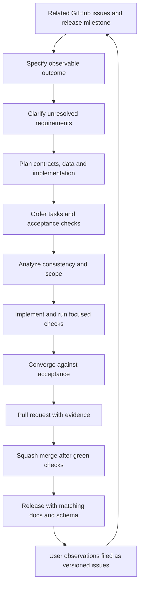

# Development workflow

Optional worker profiles use complete platform wheel hashes and isolated CPython/uv acquisition. Deterministic CI checks exercise their contracts without inference; elected CPU runs validate actual libraries and models separately. The maintainer acoustic harness reads the same builtin model manifests as the product. See [local processing setup](processing-setup.md).

## Tracking and scope

GitHub Issues are the primary work intake, milestones define release outcomes and a GitHub Project provides status. Issues state concrete acceptance, affected versions for defects, dependencies and scope exclusions. The board tracks issues and pull requests without duplicating task text. Use statuses Backlog, Ready, In progress, In review and Done, with Slice, Release, Priority and Area fields.

[Delivery outcomes](roadmap.md) describe product dependencies. Numbered implementation plans and verification records live under `specs/`; public documentation describes system contracts and does not render those planning artifacts.

## Spec Kit slices

Spec Kit organizes bounded, observable work. Python 3.11 or newer supports its cross-platform maintainer helpers. The application runtime uses the language and dependency boundaries defined in [technology decisions](technology.md).

A slice has `spec.md`, `plan.md` and `tasks.md`, with research, data-model, contracts and checklists where useful. Small work stays small; empty artifacts are unnecessary. Resolve critical consistency findings before implementation. Keep each branch and pull request focused on a coherent outcome. Dates and internal progress entries are chronological.

Resolve routine implementation choices against approved product requirements. Clarify unresolved decisions that materially change behavior.

## Building the workspace runtime

1. Use Go 1.27.1, as pinned in `go.mod`, and Node 22 or newer for documentation.
2. Run `go test ./...` and `go vet ./...`.
3. Build the CLI with `go build -o build/insonic ./cmd/insonic` (use `build/insonic.exe` on Windows).
4. Run the built executable with `workspace init <directory> --json`.
5. Select it with `--workspace <directory> workspace show --json` or discover it by running inside that workspace.

Workspace initialization validates the packaged JSON contract and cannot replace an existing workspace. Clients share a current-user local runtime; it starts on demand and exits after idle time. `jobs start <milliseconds>`, `jobs show <job-id>`, `jobs history <job-id>`, `jobs cancel <job-id>` and `jobs retry <job-id>` exercise a bounded durable qualification operation. Jobs and attempts survive owner restarts. Interrupted or expired attempts resume through fresh fenced claims; cancelled jobs remain cancelled until explicit retry. `doctor --json` reports the available catalog and configured storage/graph profiles without returning credential values or switching backends.

The desktop uses a statically bundled React/TypeScript client and packages local documentation. Run `npm ci --prefix desktop/frontend`, then its `check`, `test` and `build` scripts before native desktop qualification. Library, Jobs, Pipelines, Speakers, Terms, Models, Explore and Settings controls use the shared runtime operations. Native qualification pins exact dependencies, verifies artifact checksums and executes bounded platform/backend fixtures. Artifact availability on an architecture does not establish executed package support.

After native dependency preparation and matching documentation/frontend builds, `python scripts/package-desktop.py all --variant both` builds and qualifies CLI-only and GUI-with-CLI packages. `--variant cli` or `--variant desktop` selects one variant. Source-complete media companions retain verified source archives, build recipes, compiler identity and capability receipts. Portable artifact backups use the offline maintenance commands described in [storage](storage.md); they do not start processing workers. [Release tooling](releases.md) binds the complete four-package matrix and documentation to one reviewed clean source revision.

Native Windows build tooling gives CLI and desktop executables a process-local UTF-8 manifest so LadybugDB can open the selected non-Latin library path. Independent current-source package verification requires that manifest. Windows packages also give the pinned ExifTool launcher a process-local UTF-8 manifest so it can find its Perl runtime from non-Latin installation directories. Packaging preserves the original launcher and portable transformation recipes in corresponding sources, records original and transformed unsigned hashes, then signs and inventories the result. Archive verification reproduces those bytes independently; verified Authenticode signing permits only its declared signature envelope. The native dependency cache and system locale remain unchanged.

For durable media/model work, `insonic work wait WORK_ID --timeout-ms 30000 --json` waits through runtime IPC in one client process. The default timeout is 30 seconds and the maximum is ten minutes. It returns the observed terminal state; failed, cancelled, interrupted or timed-out waits exit nonzero and retain the last observed state. A wait timeout does not cancel the job.

Managed artifact commands share this runtime: publish/show/verify/materialize/reconcile/abort/retire, retention reference admission/release, materialization lease renewal/release and expired cache pruning. Their exact usage, default bounds and recovery behavior are defined in [storage](storage.md). They operate on real bytes through filesystem/S3 adapters, including library import/metadata, downloaded models and current recording derivatives. Dedicated desktop storage controls remain pending, while the shared bridge accepts the versioned runtime operations.

Owner locks use the private per-user runtime directory and canonical workspace root, so read-only metadata and control-directory edits preserve one owner. A runtime admits up to 1,024 active qualification workers. Terminal history remains in the selected catalog and cannot consume active-worker capacity. Runtime shutdown records interruption rather than user cancellation. Five-second attempt leases renew every second; recovery claims only expired or explicitly interrupted authority, preserving prior attempts.

## Automated checks and user observations

Before merging, run checks relevant to changed behavior, dependency/artifact integrity and reproducible builds. Secret redaction, archive extraction, job attempt ownership and graph publication require meaningful tests. Reversible text changes need formatting and link checks.

Users ordinarily verify released behavior and report observations through issues. A report includes version, platform, expected/actual behavior and a minimal reproduction. Correlate symptoms before asserting a cause. A green unrelated unit suite does not resolve a reported field observation.

## CI budget

Repository CI has parallel integrity, documentation, native-platform and alternative-backend jobs. Native checks run on Linux and Windows, including real dependency operations and the desktop bridge. Backend fixtures exercise PostgreSQL, S3-compatible storage and ArcadeDB. Foundation and documentation checks always run. A change classifier keeps stable platform check names while skipping expensive native work for prose-only changes. Runtime/catalog/schema changes run core and native acceptance plus PostgreSQL catalog fixtures; unknown paths and unavailable diffs receive full qualification. Declared Go, Wails and Ladybug binding pins must match qualification metadata. The maintained Windows WebView binding closes its controller during owned-window destruction, releases its retained COM interfaces and balances its owning COM apartment on normal exit. Its owned UI-thread system-key route preserves the original Alt/scan context before framework forwarding and keeps a claimed accelerator handled. Native menu work is posted after the synchronous callback; unrelated accelerators retain their existing handler. Repository checks verify upstream and patched source checksums and exact patch scopes for the maintained browser binding and pinned Wails host. Both local Go replacements retain their logical upstream module/version and mandatory patch notices; arbitrary local replacements are rejected. Windows startup has one first-failure outcome, and failed frontend setup skips both development and production application loops. Native calls retain owned resources until their callbacks and reentrant native frames unwind. Its local lifetime regression uses an unshown message-only window, while actual browser qualification runs on disposable CI. Package qualification compares each variant's notice inventory with its linked Go executable modules and rejects missing or mismatched licenses and patch notices. Documentation checks include KaTeX option handling and hidden headless rendering of public/offline diagrams through both themes. CI, native, package, release, site and diagnostic qualification jobs allow sixty-five minutes; their cancellation watchdogs include cleanup/evidence headroom and are separate from aggregate qualification acceptance. Dependency/source preparation jobs allow sixty minutes. Administrative issue classification retains its independent two-minute limit. Cache dependencies, cancel obsolete branch runs and consume committed assets and lockfiles. Network brand freshness checks are manually triggered.

CI documentation and parallel package-input npm installs retain advisory auditing with expanded request allowances and at most two retries, bounded inside the enclosing preparation operation. Lockfile integrity, native/package acceptance and the qualification clock remain mandatory.

Measure dependency prerequisite preparation, qualification and combined elapsed turnaround separately. Exact cache verification or the cold source pipeline, plus elected Windows Go dependency preparation, must finish at an explicit readiness boundary before elected qualification starts, including foundation and documentation checks. Qualification targets thirty minutes (1,800 seconds) and has a sixty-minute (3,600-second) hard limit; exceeding the target through the hard limit is advisory and does not block otherwise valid acceptance or merge. Functional, integrity, provenance and elected required checks remain mandatory regardless of elapsed time. Queue time within each phase is included. First-attempt preparation and combined totals include the initial request-to-attempt queue interval, which is also reported separately. Its creation timestamp comes from the identity-verified workflow record; attempt-record creation is retained separately because it can follow attempt start. Reruns use their own attempt start. Acceptance receipts expose the effective target, hard limit and target overrun. The provisional aggregate reserves sixty seconds for finalization against the hard limit and rejects work whose elapsed time plus reserve exceeds 3,600 seconds. Final terminal job timestamps and the conservative workflow metadata envelope remain authoritative, including post-job cleanup; a provisional aggregate receipt is not final timing evidence. Target overruns may inform later proportional optimization; they are not a functional failure or an additional merge gate. Native jobs build and qualify relocated desktop packages for their executed OS/architecture. CI retains inventories, checksums and receipts; public binary promotion belongs to release delivery. No CI suite, native/backend qualification or required check invokes transcription/diarization, initializes or loads their models, downloads model weights or requires engine results, including cached or small models. Deterministic stage results exercise orchestration and document/storage contracts; bounded real-media probing/extraction, preview encoding and exact Cueson operations are allowed.

Actual-terminal CI children elect the existing sanitized startup producer diagnostics. A failed campaign retains a bounded separate receipt with the executed image digest, generated request/work/startup/session identities, observed process liveness/exit, generated wait-state events and matching client-PID startup stages/native numeric errors when available. Capture precedes owned teardown; unavailable observations stay explicit. These records exclude private paths, arbitrary error text, arguments, inputs and environment values, and cannot substitute for the successful eight-case terminal receipt.

Overlapping consumer setup requires a complete unique job inventory before accepting its inputs. While scheduling changes that inventory, it may acquire up to three fresh snapshots from the first page under the same verified readiness deadline. Partial observations can anchor the earlier deadline and reject known failures, but cannot establish successful qualification. Invalid identity, ambiguous readiness, changed bounds and persistent incompleteness still fail; terminal audits require complete inventories without this setup-only recovery.

## Explicit maintainer engine qualification

Committed CC BY 3.0 speech audio and a short dialogue video are ordinary Git files under `tests/fixtures/media/`, with license/attribution, source/rendition/crop provenance, hashes, measured streams and separately declared reference expectations. Clean checkout and CI use these bytes without Git LFS or test-time media downloads. Supplied subtitles and constructed speaker turns qualify document/timing behavior, not model quality.

Actual recognition and diarization testing runs only through the explicit opt-in maintainer path. It is outside CI and merge requirements. Select installed local Python environments and registered exact managed models, record settings/device/thread/time/output bounds, and retain measured resource and quality diagnostics. No worker downloads weights or selects another provider. The local NVIDIA-preferred policy can retry once on CPU for classified CUDA failures, retaining requested/attempted/actual-device provenance. A reference-text oracle cannot be supplied as alleged generated recognition output.

`insonic processing tools CONFIGURATION.json` validates the registered `processing-tools` contract before publishing workspace configuration. Selected executables and the worker require absolute paths and lowercase SHA-256 identities; decoder configuration also requires its exact version. Positive duration, input/output, wall-time and thread limits are checked independently of inference. Omitted inference tools remain valid for supplied-subtitle assembly and export, and explicit readiness checks import libraries without loading models. Actual inference is qualified when its operation runs. New local admissions freeze `auto` by default; explicit CPU and historical frozen empty-device requests remain CPU. CUDA device/library/compute/resource failures may trigger one fresh CPU child within the original worker deadline; other failures do not.

Local inference, processing decoders and Cueson receive an explicit execution environment rather than the runtime's application/provider credentials. Preserve `PATH`, `SystemRoot`, `WINDIR`, `TEMP`, `TMP`, `TMPDIR`, `LANG` and `LC_ALL` with Windows case-insensitive selection. Preserve `LD_LIBRARY_PATH` on Linux, `CUDA_PATH` on Windows, and `CUDA_VISIBLE_DEVICES` on Linux/Windows. Inference workers receive explicit offline flags and a disposable private empty `HOME`/`USERPROFILE` for libraries that require home-directory discovery. The operator's home, application configuration and model-provider credentials are not inherited. Remove that private home after success, failure or cancellation.

Report recognition/timing agreement, speaker-count/coverage/overlap diagnostics and their reference basis separately from schema/document validity. Published subtitle display windows and editorial character labels are not sample-accurate voice activity or biometric identity truth. Distinguish measured engine behavior, deterministic regressions and unverified platforms in the qualification receipt.

Saved pipeline, speaker and terminology qualification uses deterministic local adapter results and bounded loopback hosted-worker fixtures. Protocol tests exercise actual HTTP request shape, mapping, credentials, redaction, redirects, response limits and cancellation without contacting external services. Required checks never call recognition or diarization models, download weights or use live provider inference. CLI and desktop bridge tests share the runtime contracts and explicit revision inputs.

## Documentation and contract governance

Public documentation states the authoritative system behavior. Keep slice identifiers, task records and verification evidence in internal planning. Historical and version-change descriptions belong in the [changelog](changelog.md). The documentation index carries the concise implementation-status statement.

Use numbered steps for a procedure with one linear path. Use a diagram when branches, relationships, dependencies, feedback or retry paths explain the system more clearly. Keep Mermaid flowcharts top-down with `TB` or `TD` orientation.

The software, documentation and master JSON Schema share one release version. The [JSON contracts](contracts.md) define machine-readable boundaries; the [logical catalog schema](schema.md) defines relationships and integrity. Prefer backward and forward compatibility where practical. Explain breaking changes in the changelog and concise release highlights, including the migration or affected interface.

For every major release, rescan all documentation for technical terms and refresh the [glossary](glossary.md). Each entry explains the exact term, links a primary external learning reference and points to the local pages that use it most heavily.

## GitHub setup and merging

The maintainer bootstrap configures Issues, squash-only merges, automatic merged-branch deletion, labels, milestones and a Project. The bootstrap declares `foundation`, `docs` and the always-running `elected acceptance` aggregate as required checks, alongside resolved conversations. The aggregate requires every elected scope, package producer and candidate result to succeed, rejects cancellation and unexpected skips, and explicitly records legitimate non-election. Apply and verify protection after the published checks exist.

`npm run github:check` reads setup status. `npm run github:apply` applies prepared settings to an existing repository with repository-administration and organization-Project permissions. It does not create or push a repository. Repeated setup reuses tracked issues, milestones and the Project, preserving edits, existing values and archived work. Initial status setup applies only to a new empty Project. Missing required status options or established-item metadata are reported for completion. After a partial failure, resolve permissions, rerun and confirm settings and membership through API readback.

Squash merges follow green required checks and resolved review findings. Human PR approval, code-owner approval and last-push approval are not mandatory. The bootstrap preserves zero required approvals; automated analysis and focused checks remain part of development. Agents follow the owner's authorization for the merge itself.

See [contribution guidance](../../CONTRIBUTING.md) and [release workflow](releases.md).

Maintained Pages publication stages the original accepted release export in unpublished incremental Git trees. Each serialized tree request is at most 1 MiB, including JSON escaping and its base-tree envelope. Large text and binary files use separate base64 blob requests bounded at 24 MiB within the existing 16 MiB file and 64 MiB archive limits; returned blob identities must match the original bytes. The initial tree contains only elected files, so obsolete nonhistorical content is removed. A complete recursive inventory must match every expected path, regular-file mode, size and Git content identity before a publication commit or non-forced branch update. Existing source/release/asset authority, domain and environment fences, historical compatibility routes, exact completed build and original-byte live verification remain required.

All staging, branch-update and build requests share the original enclosing promotion allowance. Request waits use its remaining time; another batch never restarts that clock. Mutative requests are serial and separated by at least one second, including pacing waits inside the same allowance. Failed intermediate staging cannot advance the public branch. GitHub JSON and asset-upload failures retain bounded method, query-free endpoint, status, request-byte count and recognized server explanations or structured error codes. Diagnostics never echo arbitrary server messages, submitted content, authorization headers or signed query values. Unrecognized or excessive server text is withheld.

Windows native preparation installs its pinned archive decoder with `python -m pip install --target build/native/python zstandard==0.25.0`. The prepared graph loader uses checksum-pinned OpenSSL ABI-3 companions, and relocated packages include their exact DLLs and Apache 2.0 notice beside the executables. No ambient OpenSSL PATH is required.

## Extracted-package connected qualification

Both package variants include `companions/processing/processing-worker.py` in their verified inventory. An elected maintainer journey uses `python scripts/qualify-journey.py --package ARCHIVE --package-receipt RECEIPT --revision FULL_COMMIT --mode controlled|real --recognition-python EXECUTABLE --diarization-python EXECUTABLE --output RECEIPT`. Real mode additionally requires exact installed `--recognition-model` and `--diarization-model` snapshots. This qualification runs outside CI in owned disposable workspaces and a private home; it does not use an operator library.

Package selection verifies archive/inventory/source receipts, clean elected revision, current versions and platform, then extracts into a directory containing spaces. CLI, media tools, Cueson and the real worker resolve only inside that installation. Development CLI/tool overrides are rejected, and ambient native loaders, tool overrides and credentials are removed from child execution. Python environments and offline models remain explicit inputs. Controlled mode records its synthetic fixture worker separately from the installed real worker.

The owned source and restored runtimes each report readiness with correlated startup and workspace IDs before observation commands begin. Each join retains its original sixty-second readiness allowance, bounded by the overall journey deadline. `runtime_startups` retains only validated generated fields, elapsed time and effective budget; invalid, failed or late reports cannot authorize later stages.

The connected journey covers generated current transcripts and source maps, speaker enrollment/profile selection, roster-constrained matching, native queries, self-contained backup, source withdrawal and exact current-authority recovery in an empty destination. Receipts distinguish package source identity from the maintainer harness and identify exact inputs. Successful connected operations establish execution and recovery for those fixtures; they do not establish independent biometric accuracy, attended GUI behavior or unexecuted platform inference.

For reference-backed Windows CPU acceptance, add `--reference-corpus tests/fixtures/acoustic/manifest.json` and omit the two interpreter arguments. The committed corpus manifest digest is checked before package execution, so caller-supplied audio/references cannot claim the frozen source provenance. This election requires a clean current complete package and prepares recognition and diarization environments sequentially through the ordinary `workers plan` and `workers setup` contracts. Each setup submits the returned plan identity, verifies completion and verifies reuse before inference. Its receipt distinguishes fresh snapshot verification from two repeated lightweight inspections of the same immutable environment. These modes do different work and do not claim flushed operating-system caches. Exact local model snapshots pass through normal model preparation, acquisition and integrity checks. `--managed-offline-assets DIRECTORY` optionally selects a complete declared dependency bundle. Preparation and qualification elapsed times are recorded separately, along with combined execution time. Linux qualification observes the owned session across nested worker process groups and verifies their exit; termination binds process identity through pidfds.

The retained licensed originals freeze transcript and reader references before inference. Two readers enroll from separate clips, then matching evaluates different utterances, an unenrolled reader and a sequence derived from both held-out clips. The sequence records exact sample positions and silence. Receipts report per-case substitutions, deletions, insertions and word denominators using Unicode NFC, case folding and word tokens, plus native speaker decisions and their independent reader comparisons. Accepted work is a functional result; incorrect, unknown, ambiguous, missing and mixed-reader predictions remain visible quality outcomes. Sequence totals repeat held-out speech and are scenario-weighted. Source windows include silence and do not provide independently annotated speech boundaries or a diarization error rate. These short clean read-speech fixtures do not establish general recognition or speaker-identification accuracy, or absence from pretrained training data. Profile enrollment derives embeddings rather than retraining model weights.

Reference acceptance also checks every current cue's source positions, exact playback bytes and handle release, native queries and both fetched profiles before and after self-contained restore with the original library unavailable. Source-only receipts report destination prerequisites separately from recovered accepted results. Extended receipts additionally prepare verified destination workers and require fresh held-out recognition, diarization and speaker matching with new terminal work identities and increasing recording revisions. They verify retained canonical media, profiles and completed work history while allowing ordinary current-transcript supersession; source paths remain unavailable, and destination setup stays within the original qualification clock. All required stages, corpus cases, model/environment/package identities, quality accounting and owned runtime/temporary-directory cleanup must complete before the atomic receipt can state success. Real inference remains explicitly elected outside CI; ordinary CI exercises deterministic reference, failure, provenance and cleanup regressions.

CLI qualification records owned-launch time, observed process wait and total invocation time separately for cold credential-bootstrap refusal. The sixty-second test classification allowance applies after job assignment and primary-thread resumption; the complete invocation remains inside hosted CI elapsed accounting. Reference acceptance rejects a dirty or different harness revision before execution and rechecks its source identity before final cleanup. Qualification elapsed time includes owned temporary-directory removal.

## Documentation reuse in qualification

Scope classification elects preparation before the qualification phase. Only known presentation and documentation changes skip native qualification; unknown, mixed, dependency, schema, runtime, packaging and workflow changes elect the complete checks. Source compilation can begin after scope selection, but runtime, package and adapter consumers still require successful foundation checks.

The documentation producer builds one exact-source public/offline export and binds both archives to source, version, workflow run and attempt with size/SHA256 identities. Documentation browser qualification and native consumers restore that same export from a digest-checked artifact. Missing, redirected, stale or mismatching transfers fail without a local rebuild fallback. Native jobs retain dependency installations for notices and all desktop, relocation, CLI, installer and artifact checks. Release qualification independently builds its documentation unless the CI-specific reuse input is explicitly enabled. Windows package setup starts after verified prerequisite readiness. Before product compilation it requires successful foundation and documentation producers through a gate bounded by the original readiness timestamp plus 3,600 seconds; that gate never restarts the qualification clock. Independent source/module verification and notice dependency installations join before product work, and unused default Go cache restoration is disabled when the verified dependency handoff replaces it. Maintainers can elect `cold_media_source` on a manual CI run to isolate compiled-media caches in a run-specific namespace; a complete rerun retains that namespace for verified warm comparison. Original source archives retain their existing checksum-verified reuse, and ordinary CI cache keys are unchanged. Verified warm and cold preparation paths have an explicit terminal handoff; failed or cancelled preparation cannot start consumers. Exact caches accelerate preparation, while missing, evicted or invalid inputs follow cold preparation without widening restore keys or bypassing checksum verification. Expanded artifact-transfer allowances remain bounded by the original qualification phase deadline. Same-run/attempt artifact digests, recipe/compiler/source checks and receipt rehashing remain required. Windows package dependency preparation starts with an empty isolated Go build cache and compiles only standard and external module libraries for the exact package contexts. Product packages, executables and tests remain inside qualification. Package consumers verify source, run/attempt, recipe, Go/compiler, resolved system packages, native pins, context and archive identity before activating the prepared cache; missing or mismatching transfers fail without a warm-cache fallback. Release workflows retain their independent path unless this CI reuse is explicitly enabled. Source jobs retain resolved package inventories as observations, separately from the existing compiler identity; this does not claim a fully pinned compiler/linker/runtime environment. Candidate aggregation waits for foundation, documentation browser qualification, source producer success and both platform package results. Restricted-session capture initialization may retry once in fresh owned workers after its exact startup timeout; assertion failures and a repeated timeout remain failures. Worker test wrappers and job watchdogs follow the expanded qualification timing policy; ordinary product-operation deadlines remain separate.

An explicit site_smoke maintenance dispatch runs foundation, documentation and the read-only live-site job without duplicate native package builds. Ordinary dispatches and unavailable PR/push diffs still select full qualification. Main publication accepts only the exact completed push/main run, so a maintenance smoke cannot substitute for product qualification.

## Versioned screenshot provenance

Documentation screenshots describe their recorded clean capture revision and version. Image bytes, dimensions, accessible captions and source hashes remain checked. If current source has moved, the builder verifies every recorded source hash and the captured VERSION against immutable Git blobs from that exact commit, which can predate later corrections on a squash-merged branch. A complete matching ancestral snapshot remains valid when the original commit is absent. If neither proof is available locally, the builder retrieves only the pinned commit from the configured HTTPS or local Git origin, without changing HEAD, branch refs, FETCH_HEAD or tracked files. Credential prompts and other transport helpers are disabled; retrieval and all history checks share the original bounded deadline. No historical code executes. Unavailable proof, mismatching hashes or the wrong captured version fails the build. Capture receipts and PNGs are not rewritten to claim that an older image came from newer source. Current application UI capture qualification still runs separately in native CI, using the current source and an isolated headless browser.

The current source implementation gives native query and explain RPCs a 25-second aggregate budget covering current graph publication and execution. The engine retains its twenty-second query ceiling, bounded by the remaining RPC time. An earlier caller deadline or cancellation ends the client wait. Transport timeouts are cancellation conditions, not evidence of malformed query input. Immutable release binaries retain their tagged implementation.

Source and Windows artifact joins allow at most three attempts per metadata read for recognized transient connection failures and HTTP 408, 429, 500, 502, 503 or 504. Backoff is one second then two seconds, bounded by the original artifact/qualification deadline; each request uses its remaining time. A permanent failure cancels and joins the sibling metadata request before returning its original cause. TLS, refused redirects, unclassified transport errors, authentication errors, malformed or oversized inventories, identity/digest failures and failed producers remain immediate failures. Metadata retries do not rerun product tests or authorize partial/stale inputs.

After an exhausted artifact-service failure, rerun complete qualification so all producers and consumers use one current workflow attempt. Isolated consumer reruns cannot substitute artifacts from an older attempt.

## Startup error reporting

Returned desktop startup errors retain their original Go error chain and a generated workspace, playback-transport, desktop-window or desktop-close stage. Ordinary GUI launches use native Windows or GTK error presentation as well as stderr. Private startup events retain only allowlisted stages and an optional unsigned numeric system error; arbitrary cause text remains outside persisted diagnostic events. Diagnostic storage and presentation failures leave the original startup error authoritative. Windows new-file securing applies the required protected current-user DACL before reopening for necessary default-owner normalization. Existing foreign-owned files are refused before any DACL change, and reopened handles must match the original regular file. Tests inject both sinks without showing dialogs or touching real user profiles. Controlled fake-COM and message-only tests cover synchronous/asynchronous failures, interrupted initialization, late completion, resource release and fresh instances. Windows source and packaged qualification additionally obstruct one disposable profile path with an owned regular file, require a returned native startup failure plus private diagnostics and natural child/descendant release, remove only that verified blocker, then run the original twelve cold/warm Exit cases using the intended profile paths. The recovery receipt is required in addition to all existing native results; qualification operation allowances follow the shared test timing policy.

Private Windows log and lock creation initially requests READ_CONTROL, WRITE_DAC and FILE_READ_ATTRIBUTES. WRITE_OWNER is requested only when a newly created file actually needs owner normalization, after revalidating the original handle identity and reparse state. Existing files must already belong to the current user. Protected current-user-only ACLs, rotation and exclusive writer ownership remain required.

## Desktop control and Exit qualification

The Wails host applies consumer-owned composition using the delivered interface, spacing and typography tokens. The governed kit remains byte-for-byte upstream. The checkbox glyph uses native appearance at the body token size; its associated compound label retains the minimum interaction target. Ordinary actions size to their content. No undocumented density component property or preference is required.

Application capture observes Setup, Library, Jobs, Pipelines, Models and Settings at 1200 by 800 and 720 by 600, with renderer scales 1, 1.25, 1.5 and 2 and normal or 200% text. Its separate density receipt records all 96 observations and seven representative images. The regular setup receipt retains its four original landmarks. Native journey checks additionally observe actual processing controls after opening an imported recording.

Source and extracted-package native Exit qualification activate the owned Windows keyboard menu path or GTK menu item, then require normal GUI process termination. A separate fixture owner hosts the real runtime and a held synthetic model acquisition. Direct IPC must report the same runtime session and durable work identity after each GUI exits, with playback handles and the loopback listener released. Releasing the byte barrier must let the acquisition finish. Ordinary close is checked alongside Exit; Windows also checks Alt+F4 through native input, requiring the fixture window to be owned, visible, enabled and foreground before delivering the chord. Only the fixture owner cancels its own runtime context after completion. Windows menu qualification also requires the actual native system-key route, then real X input and the Exit callback. No callback or forced-process fallback can produce a successful Exit receipt.

Desktop CI cache keys include the root, frontend and documentation dependency locks. Candidate collection can use `--summary` for concise completion metadata and the full manifest digest in logs; the complete verified manifest, asset checksums and package inventories remain in the candidate artifact. The default maintainer command output remains unchanged.

Native Exit failure diagnostics retain separate bounded standard-output and standard-error streams, the last startup/action checkpoint, actual child exit status and deadline/truncation classification. Successful machine-readable receipts remain separate. Explicit manual incident replay verifies the selected historical package and records diagnostic-tool identity separately; derived source probes and failure observations cannot replace complete package qualification or authorize publication. A failed Windows proof producer retains its exact run/attempt/source and scope before the join rejects it, so secondary missing completed receipts do not obscure the primary failure. A successful diagnostic replay does not establish the cause of an intermittent startup failure.

The disposable Windows archive CI lane allocates its launched CLI workload to three of the configured four CPUs while GUI qualification runs concurrently. This covers the installed PowerShell first-use journey, main CLI commands and contract media/example/terminal helpers, including inherited detached-runtime affinity. Each explicit root receives and verifies its mask before execution; fixed receipts distinguish those verified roots from inherited descendants. The shared parent and GUI jobs retain their existing affinity. Unsupported topology or allocation failure stops qualification before launching the workload. Commands, parallelism, all twelve cold/warm Exit cases, native input and natural-release checks remain required under the expanded test timing policy. This allocation excludes one CPU from the launched CLI workload; other system activity can still use it. The receipts describe CI execution and do not establish installed-desktop behavior.

The private native wait-query helper accepts its bounded request only over an inherited input pipe created by a live parent running the same executable file. The operating system supplies the pipe creator identity, and the parent retains the existing owned-window target selection. Direct invocations with another caller, a copied executable or an unverified channel fail before a wait query. Parent identity remains live through the query, and the existing observation deadline and content-free output bounds remain required.

Successful qualification waits use a shared, committed test timing policy across native code, frontend checks and maintainer scripts. Help has a 180-second native execution allowance plus thirty seconds for teardown (210-second capture); full GUI execution allows 600 seconds plus thirty seconds for teardown. Native Exit gives each child a 180-second fixture watchdog and a 210-second capture allowance, with a 2,760-second repeated-case matrix. Readiness and native UI/action observations allow sixty seconds, and frontend mounting/loading allows 120 seconds, always bounded by an earlier enclosing deadline. These are maximum allowances, not sleeps: checks return as soon as an outcome is known. The fixture reports effective remaining time rather than promising a fresh full allowance after earlier stages. Short explicit calibration arms, polling cadence and injected deadline/cancellation fixtures retain their documented purpose. Normal user-selected product deadlines are unchanged. Fixed allowlisted help-stage observations retain monotonic native/frontend elapsed time separately, so buffered log arrival is not treated as stage execution time. Passive observations support diagnosis; actual native actions and natural release determine success.

## Maintained CLI regression corpus

`python scripts/cli_corpus.py --check` validates the versioned fixture catalog at `tests/fixtures/cli-corpus.json` offline. The catalog references existing generators, assertion owners and licensed-media provenance; it adds no external service requirement. Changes to pinned media metadata require an intentional catalog hash update. Paths must remain within the repository, Python assertion symbols must exist, and malformed, duplicate or oversized entries fail validation.

Source and installed-package CLI qualification derive a coverage ledger from the executed binary's contextual help. Every advertised command and accepted option has an explicit disposition: asserted success, invocation only, observed refusal, parser rejection only, help only or unverified. Help traversal and successful exit alone establish no semantic success. Durable completion, verified materialization and the owned runtime readiness check identify their assertion and scenario. Authority-building help/parser observations are replayed after help defines accepted options. Failure groups retain only code/reason values from the runtime response schema; human-only failures with no machine envelope remain explicitly unclassified. Existing helper scenarios retain their detailed semantic checks separately. Source lanes explicitly leave companion-dependent scenarios unverified. Argument values, credentials, raw output and local paths are excluded from coverage observations.

The nested `coverage` receipt binds the catalog, actual CLI image, version, platform and architecture. Package qualification also binds its previously verified archive and inventory digests. Existing installed and library destinations include spaces and non-Latin text, and owned fixture servers must stop after joining. The bounded ledger fails on overflow. Synthetic fixtures establish these contracts; they do not establish independent inference quality, external authorization, physical hardware or behavior on an owner's installed desktop.

Source and extracted-package CLI qualification additionally exercises actual headless Windows and Linux terminals. An independent owned runtime holds deterministic model acquisition after one verified file so human waits must expose changed state and count progress. Terminal Ctrl+C must naturally end only the client wait; the same independently observed work must continue and succeed after its barrier releases. Explicit durable cancellation, wait timeout, checksum failure and JSON/quiet/redirected-output controls remain distinct. The bounded terminal receipt binds the executed image and platform, requires natural client/runtime exit and verifies owned terminal/server/fixture cleanup. Release qualification checks its package and image correlation. These automated fixtures do not establish behavior on an owner-installed release.

## Refreshing dependencies with maintained local sources

The desktop framework and Windows browser binding are repository-local replacements with separate pristine-upstream and patched-tree identities. Ordinary Go resolution uses the local trees, so tidy can remove their pristine upstream sums even though source and package verification still require them.

1. Retain the existing archive and `/go.mod` checksum entries for both versions identified by `third_party/wails.source.json` and `third_party/go-webview2.source.json` before refreshing the selected dependencies.
2. Use the pinned Go compiler to update only the elected modules, then run `go mod tidy`. Download the exact pristine upstreams with `go mod download -json github.com/wailsapp/go-webview2@v1.0.23 github.com/wailsapp/wails/v2@v2.16.0`.
3. Compare each returned `Sum` with its source manifest and retained archive entry, and `GoModSum` with the retained `/go.mod` entry. Restore only those four exact verified entries to `go.sum`; explicit-version downloads do not necessarily persist sums for replaced modules. Reject a mismatch rather than overwrite conflicting authority.
4. Run `go mod verify`, `npm run check` and the source/notices regressions before package qualification. Both independent source verifiers require exactly one matching archive entry and one matching `/go.mod` entry for each maintained module; module-file checksums derive from the pristine manifest’s `go.mod` content hash using Go’s checksum format. Missing, changed or conflicting entries fail. Keep local replacement directories, manifests, patch scopes and source notices unchanged unless their own reviewed update is intended. Runtime notice membership comes from linked binaries, separately from dependency tool/test graphs.

Current capture tooling derives its exact Playwright version from the root package pin and rejects a mismatching installed toolchain or new capture receipt. Previously committed screenshots keep their original versioned source receipts and are validated through immutable history.

Source and extracted-package CLI qualification additionally exercise abrupt runtime loss during canonical import on disposable filesystem/SQLite workspaces. Hash-pinned configured probe fixtures and external source-file barriers observe durable canonical/report publication before admission. A Windows RW oplock requires acknowledgement; a Linux write lease respects its existing kernel break allowance. Qualification kills and reaps the exact owned runtime while that barrier remains held, then starts a distinct runtime under ordinary work expiry and catalog fencing. Same-source recovery must retain bytes, raw metadata, date provenance, prior attempt receipts and duplicate-free acceptance; equal-length source changes and corrupt reports must refuse stale admission. Existing accepted fixture authority and all owned process/barrier/path cleanup are independently checked. The nested recovery receipt binds image/platform and existing package archive/inventory authority. Current and unknown package receipts require this evidence; exact immutable original v1.0.2 receipt hashes alone may predate the new field, with all prior release checks still enforced. Neither a product fault switch nor physical power-loss simulation is used.

Maintained storage qualification separates native injected partial-write, disk-full, persistence and cleanup faults from an actual filesystem publication obstruction. A configured hash-pinned probe creates one owned regular-file blocker at a new canonical digest parent. The import must fail without changing its source or an accepted sentinel recording; removal of that exact blocker permits a distinct ordinary import with verified canonical/report bytes, metadata/date provenance and idempotent replay. Windows/Linux source and extracted packages retain source/image-bound receipts and require natural runtime/fixture cleanup under the existing enclosing deadline. This exercises filesystem refusal and recovery without filling a host volume; it does not establish physical disk-exhaustion or power-loss behavior.

## Recording workflow qualification

Installed Windows and Linux CLI qualification includes an owned 34-second stereo PCM fixture and deterministic loopback adapter responses. It exercises canonical admission, separate channel windows, interruption after verified checkpoints, resume, coverage denominators, two disjoint repairs, current transcript retrieval and temporary publication retirement. The invocation ledger rejects work on unrelated windows and verifies that resumed checkpoints avoid repeated inference. Native subtitle tests cover SubRip, WebVTT, ASS and SSA preservation; catalog tests share acceptance and replay assertions across SQLite and PostgreSQL, alongside the existing storage and graph backend qualification.

These deterministic results establish orchestration, provenance and integrity behavior. They do not establish acoustic accuracy or CPU/NVIDIA model execution. Real model qualification remains separately elected with exact models, devices and retained receipts. Qualification timing uses the shared preparation/readiness boundary, thirty-minute target, sixty-minute hard limit and sixty-second finalization reserve; a target-only overrun is advisory.
