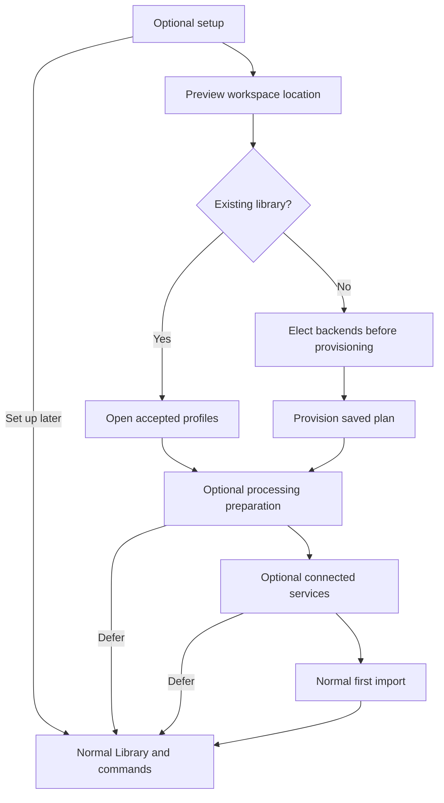

# Optional first-run setup

Setup offers a guided route from a new library to its first import. It is optional: skip a stage, choose Set up later or use the ordinary workspace/import commands at any time. Reopen Setup from Settings to continue with the same accepted choices. CLI and desktop use shared versioned state and the same backend, processing, service and import operations.

Local defaults use filesystem artifacts, a SQLite catalog and a LadybugDB graph. Creating a library and importing media require no account, API key or model download. Processing and connected services are separate elections. Current installation prerequisites still apply; see [CLI and desktop installation](desktop.md#native-package-layouts).

## The five stages

| Stage | Choice and effect | Skip or return |
| --- | --- | --- |
| Workspace | Preview an editable location or open an existing library; fresh creation follows backend selection. | Use an existing library or leave setup for later. |
| Backends | Keep local defaults or elect filesystem/S3, SQLite/PostgreSQL and LadybugDB/ArcadeDB before creating a fresh library. | Existing accepted profiles remain authoritative; migration uses the normal maintenance operations. |
| Processing | Inspect hardware and task readiness, preview managed local setup or use an existing environment, prepare elected models and save a pipeline. | Admission-only import remains available. Accepted preparation work stays in Jobs. |
| Connected services | Discover service metadata and explicitly elect an endpoint/model route. Register protected credentials when needed. | Discovery alone adopts no route. Ordinary direct queries remain available. |
| First import | Open normal Import controls or use the CLI, then inspect the resulting work. | Finish setup or return to Library without importing. |

Back, Skip and Set up later save journey progress without undoing accepted configuration. Retry an affected operation through its existing controls. Completed and skipped stages are distinct from pending stages; a completed stage whose current configuration no longer matches its observation is shown as needing attention. Setup completion never gates other commands.



## Choose a location

The suggested path is the platform user-data directory followed by `libraries/My voice archive`. Edit it before accepting. Location preview reports the selected path, existing library state, control/artifact/cache locations and observed capacity at the nearest existing directory without creating the destination. Installation files and library data have separate ownership; setup rejects a new library inside the application installation.

Control files hold workspace identity and catalog configuration. Managed artifacts contain accepted media, derived content and model bytes according to the elected storage profile. Disposable caches/materializations support work and playback. A remote storage choice can put artifacts elsewhere while retaining local control and scratch files. Metadata, media and model growth depends on later selections; the initial preview reports unknown estimates rather than inventing a total. Normal worker/model preparation previews provide their own observed requirements. See [storage](storage.md) and [local processing setup](processing-setup.md).

An existing library is opened with its existing identity and profiles. Setup does not overwrite it or convert fresh provisioning into migration. Use the documented backup/migration operations when moving accepted data to different backends.

## Start through the CLI

Every setup command is noninteractive and supports `--json`. Use contextual help for the installed input contracts. Setup location and bootstrap-draft commands work before workspace selection.

1. Preview the suggested location, or supply an explicit path:

   ```text
   insonic setup location --json
   insonic setup location "YOUR_LIBRARY_DIRECTORY" --json
   insonic setup draft show --json
   ```

2. Write `setup-draft.json`. Replace `YOUR_LIBRARY_DIRECTORY` with the chosen path and use the revision returned by `setup draft show` (zero for an unsaved draft). Omitted profiles elect the local defaults:

   ```json
   {
     "expected_revision": 0,
     "path": "YOUR_LIBRARY_DIRECTORY",
     "plan": {
       "schema_version": "1.0.3",
       "kind": "backend-plan",
       "display_name": "My voice archive"
     },
     "stage": "backends",
     "status": "active",
    "credential_backend": "native"
   }
   ```

3. Save with a fresh request UUID. Preserve the file and that UUID for reconciliation of an unknown response; replace the illustrative UUID below for each new save. Read the accepted normalized plan and retain its generated workspace/profile identities:

   ```text
   insonic setup draft save --input setup-draft.json --request-id 11111111-1111-4111-8111-111111111111 --json
   insonic setup draft show --json
   ```

4. Provision the saved draft explicitly, then select its library. Local defaults need no protected input:

   ```text
   insonic setup provision --json
   insonic --workspace "YOUR_LIBRARY_DIRECTORY" setup show --json
   insonic --workspace "YOUR_LIBRARY_DIRECTORY" doctor --json
   ```

5. Skip optional processing/services or configure them through their ordinary commands. Import through the existing operation, then inspect work:

   ```text
   insonic --workspace "YOUR_LIBRARY_DIRECTORY" media import "YOUR_MEDIA_FILE" --copy --json
   insonic --workspace "YOUR_LIBRARY_DIRECTORY" work list --json
   ```

For alternate backends, the draft's `plan` accepts a `backend-plan` or its normalized workspace configuration. Use [complete backend planning and preflight](storage.md#configure-and-preflight-backends) to check the selected services before provisioning. `setup provision` accepts `--credential-backend native|vault|session` and `--secret-input`; protected values come from stdin using the existing bootstrap channel. Keep values out of the draft and command arguments. The draft retains its nonsecret credential-backend election; an explicit provision override saves that election before creating the library. Preserve the saved normalized plan when retrying provisioning. Bootstrap drafts retain the most recent 64 request receipts; older stale retries report a conflict without repeating effects.

## Save and resume a library journey

`setup show` reads current state without starting workers or downloads. If no journey was saved, it supplies defaults alongside current library observations. `settings setup` is the readback/reopening alias. `setup save --input FILE` changes bounded journey metadata only; it cannot provision backends, create a pipeline, download models or import media.

A save file contains `expected_revision` and `state`. State includes `status` (`active`, `deferred` or `completed`), `current_stage`, exactly five unique stage records and `choices`. Stage IDs are `workspace`, `backends`, `processing`, `services` and `import`; their saved states are `pending`, `completed` or `skipped`. `choices` contains `processing_mode` (`none`, `local`, `connected` or `custom`) and optional selected `pipeline_id`/`pipeline_revision`. Start with the returned state and copy each current `observations[stage]` SHA-256 proof into that non-skipped stage before making the intended change; only skipped stages may omit it. See `setup save --help` for the complete template.

Use the observed revision when saving and a new request UUID for each new intent. Repeating the same immutable save with the same UUID reconciles the accepted result. A response distinguishes its accepted revision from potentially newer current state; replay does not restore old choices over newer saves. A stale save or changed input under an existing request ID returns a conflict. Read current state and decide the next change without overwriting the accepted revision.

Configured profiles, model records and durable work retain their own authority and retry identities. Deferring, skipping or closing setup preserves these effects. Use Jobs or `work cancel` to cancel a selected job, and its supported retry operation to resume interrupted work. Moving a library or restoring a portable copy requires fresh destination observations; a saved completion marker alone cannot establish current readiness.

## Readiness and credentials

The final summary distinguishes configured choices from usable capabilities and links the relevant Import, Settings and Jobs actions. `setup readiness` explicitly requests the shared task-specific processing checks using the saved pipeline election, or the generic readiness input when no pipeline is selected. A failed transcription, diarization or training prerequisite does not remove ready admission-only import. Missing environments, model bytes, devices and adapters name their corrective action. See [local processing readiness](processing-setup.md).

Connected-service discovery inspects metadata without loading a model or electing a route. Its separate synthetic test can exercise the selected route. A registered credential reference, a saved configuration, successful authentication and task usability are different observations. Desktop forms name the credential task in plain language, accept protected values and generate an opaque reference; only the reference enters configuration. CLI values use the [protected credential channel](secrets.md). Setup state rejects credential values, signed URLs, arbitrary settings and unknown fields.

## Offline use and recovery

The same setup guide is bundled with the installed documentation. Local library creation and admission use packaged companions and need no network. Managed environment/model preparation requires its elected sources to be available; offline inputs and exact existing model snapshots use the normal processing preparation controls. Skip these stages when their prerequisites are unavailable and continue with import.

Setup retains stage progress across client closure and can be reopened from Settings or CLI. A changed configuration can require a new observation proof; a failed effect remains inspectable in Jobs. No unattended download, provider substitution or hidden route change follows from a journey save. Existing explicit routing and configured work continue under their accepted selections.
