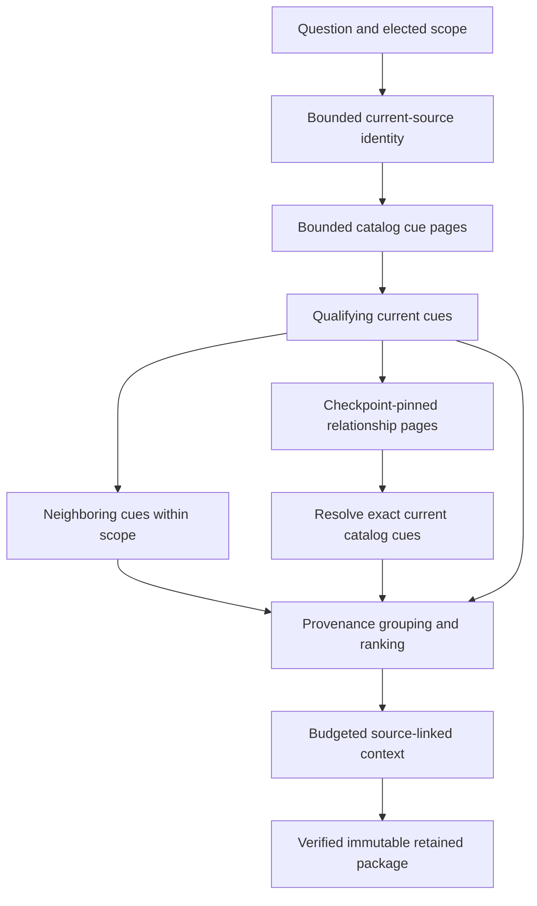

# Answer evidence and context

Evidence preparation collects current source spans for a question, explains their selection and provenance, and fits source-preserving extracts into an explicit context budget. It does not synthesize an answer or call an inference provider. The shared answer envelope supports later claims and citations; validation checks current source authority and faithful quotes, without claiming that a quote logically proves a claim.

These commands are available in builds containing the evidence/context capability. Published package availability follows the [release notes](changelog.md). Dedicated desktop controls follow; the shared runtime already accepts the same requests as the CLI. Ordinary [search and graph queries](graph.md) remain available independently.

## Prepare and inspect

Save a request as `question.json`:

```json
{
  "version": "1.1.0",
  "question": "Which recordings describe changes to the launch plan?",
  "filters": { "text": "launch" },
  "traversal": { "direction": "both", "max_depth": 4 },
  "budget": {
    "items": 64,
    "context_bytes": 32768,
    "context_tokens": 8192
  }
}
```

```sh
insonic answers prepare --input question.json
insonic answers prepare --input question.json --json
insonic answers show PACKAGE_UUID
insonic answers export PACKAGE_UUID --json
insonic answers validate --input answer.json --json
```

`prepare` returns a retained package UUID when persistence succeeds, the evidence/context package, current source freshness, cache reuse and measured work. `show` and `export` read the same verified immutable package and report current freshness separately. Use `--json` for the complete versioned response and redirection. Human output puts state, freshness, graph limitations, context omissions and continuation before details.

A package can be `complete`, `partial` or `insufficient`. Completeness describes evidence preparation, not successful answer synthesis. Cancellation returns a non-success error with the available partial observation; an unretained attempt has no package UUID. Missing or stale graph publication remains visible even when current catalog cues are usable. Preparation never implicitly publishes or rebuilds the graph.

## Bounded retrieval

The selected SQLite or PostgreSQL catalog is authoritative. A bounded source-identity scan establishes the current recording, document, mapping, date, provenance and assertion identity. Cue pages select one recording before expanding its transcript; the runtime does not export and hydrate the whole library. Exhausting the identity allowance reports `source_identity_budget`; narrow `filters.media_ids` or elect a larger allowance before proceeding.

Text, entity and concept filters select seeds. Media, current speaker, recording-calendar and exact source-interval filters remain enforced during neighboring-cue and relationship expansion. Without a text filter, question terms affect ranking rather than excluding all other text. Entity IDs are normalized graph identities. Concept IDs distinguish subject, relation and object roles, so equal labels in different roles are not silently merged.

LadybugDB and ArcadeDB use the same bounded neighborhood contract. Each graph page pins workspace, target, generation and sequence, supports relationship kinds and direction, and continues by edge identity. A four-edge route can connect a source cue through its assertion, a shared concept and another assertion to a second recording's cue. Every admitted cue is resolved against its current catalog document. Stale/missing graph references are excluded or diagnosed; disconnected sources do not become related merely because their text is similar.



Defaults and hard caps:

| Allowance | Default | Hard cap |
| --- | --- | --- |
| Scanned source-identity/candidate rows | 4,096 | 100,000 |
| Fetched source/cache bytes | 4 MiB | 8 MiB |
| Selected evidence spans | 128 | 500 |
| Serialized selected evidence | 256 KiB | 512 KiB |
| Graph edges | 128 | 1,000 |
| Logical catalog/graph/cache read rounds | 32 | 256 |
| Aggregate deadline | 20 seconds | 60 seconds |
| Graph depth | 3 | 8 |
| Neighbor cues on each side | 1 | 8 |
| Full serialized context | 32,768 bytes | 262,144 bytes |
| Conservative context token units | 8,192 | 262,144 |

Omitted or zero numeric allowances use their defaults, except `neighbor_cues: 0`, which disables neighbors. Source freshness checks share the aggregate allowance and reserve work before retrieval. Context byte and token allowances apply together; the smaller effective limit wins. The complete retained package has a separate 1 MiB bound. A limit either produces an explicit incomplete result or a typed non-success result, never an oversized successful package.

When `package.next` is present, copy it into the next request's `cursor` while keeping the question, filters, configuration and budgets unchanged. It continues the catalog scan against the same source epoch, including pages with no matching seeds. Changed authority rejects the continuation. Graph and context omissions remain explicit; rerun with a larger elected allowance when those details are needed. Continuation does not silently combine earlier packages into a synthesized answer.

## Provenance and reproducible ranking

Exact source digests and accepted canonicalization origin facts establish source families. Known stream/channel identity and overlapping source intervals establish overlap groups. Unknown cross-recording stream identity does not prove overlap. Equal text never proves common origin. Distinct observed source families retain the possibility of an unknown shared upstream origin; their count is not an acoustic independence certification.

Repeated imports, overlapping cues and repeated extracted assertions retain inspectable source members while receiving independent-family and overlap-coverage credit once. Reported/quoted assertions do not add independent support. Independent sources with similar wording remain distinct. Opposite polarity for the same asserted subject, relation, object and conditions is recorded as a conflict; different conditions or a different object alone do not prove contradiction.

Ranking uses question-term overlap, distinct-family credit, overlap coverage and opposing-family conflicts. Its total is four times relevance, plus twice independence, plus coverage, plus twice contradiction. Ties use evidence identity. Conflicting evidence remains visible rather than being suppressed by a confidence score. Contradiction detail is bounded to 500 pairs and 64 KiB, with a visible exclusion when more detail exists. No answer confidence is inferred from this score.

## Context and cache authority

Context contains cue extracts, sections of sixteen source cue ordinals, recording nodes and a cross-recording node. Higher levels organize links to underlying evidence; they are not additional sources. Cue text is an exact source prefix of at most 1,024 Unicode code points, shortened further when necessary. Condensation and omitted evidence are explicit. A later reader can resolve each source ID through the retained package.

Byte accounting includes the entire serialized context, question, hierarchy, source links and accounting fields. Token units conservatively use UTF-8 bytes of that envelope; they do not claim to reproduce a provider's tokenizer. The `source-extract-v1` contract rejects invented summary text. No context node has stronger or independent authority than its source cues.

Cache identity binds workspace, effective question/scope/budgets, current source/document/speaker/date/provenance/assertion identity, graph observation, elected provider/model, nonsecret configuration digest, prompt identity and summary contract. Provider identity is optional for preparation and contains no endpoint or credentials. Preparing context makes no provider request.

Packages use the configured filesystem or S3 artifact storage and SQLite or PostgreSQL catalog. Immutable bytes are hash-verified, explicitly retained, and indexed through a workspace-scoped compare-and-swap pointer. Cache metadata and artifact writes do not change semantic source identity. A corrupt pointer or failed byte verification is a diagnosed miss; recovery creates a new publication instead of overwriting historical bytes. Lost responses and concurrent pointer writes are reconciled against persisted state.

Inspection reports `current`, `stale` or `unknown` source freshness. Source replacement, mapping/date changes or incompatible configuration prevent reuse. Historical packages remain readable; inspection never rewrites their original observations. The package's usage records work at serialization, while the response's usage includes current request checks performed after publication or during cache reuse.

## Claims and citations

An answer envelope names its retained `package_id`, version, state and claims. A `supported` claim requires citations. `unsupported`, `uncertain` and `conflicting` claims require an explicit uncertainty reason and cannot appear in a completed answer. Each citation binds the evidence member, exact reference and a faithful source quote. Revisions, cue ordinals and microsecond intervals use decimal strings so large values remain exact in JavaScript clients. Untimed sources omit the interval.

Validation checks every citation against the retained package and current catalog evidence, including multiple quotes from the same cue. Forged workspace/document/mapping/timing identities, stale sources and invented quotes are rejected. Passing citation validation establishes source provenance, not semantic entailment, factual truth or completed answer generation. See the generated [JSON contracts](contracts.md) for complete request, package and answer-envelope shapes.
