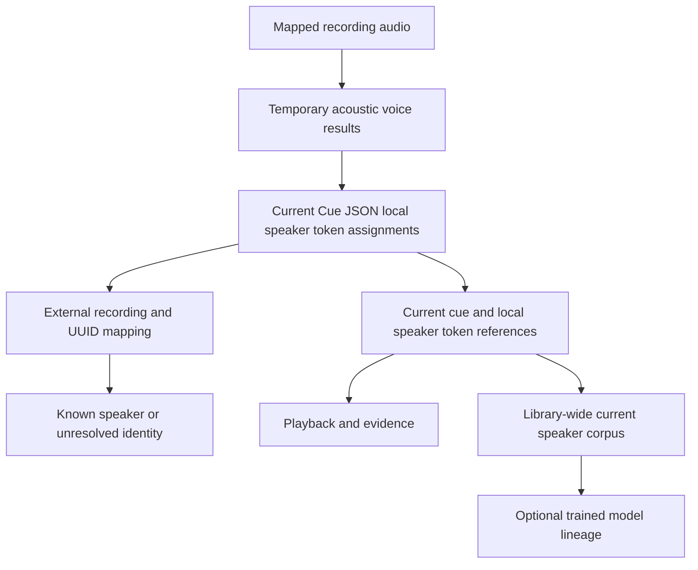

# Speakers and terminology

## Local voices and known speakers

A diarization voice belongs to one recording. Its local token occurs in the current embedded Cue JSON document; it is not a global person ID. The same person in another recording receives another local speaker token. Imported tokens retain their exact upstream-valid values. Native subtitle labels and mentioned names remain source observations, independent of that identity. A catalog speaker is a stable user-facing identity with a canonical name, active state and revisioned aliases.



Acoustic diarization describes which voice spoke when. Known-speaker mapping describes who that voice may represent. A mentioned person, quoted statement, scene participant and speaking voice are different observations. Unsupported identity remains unresolved and does not block valid source-level operations. Model confidence is a diagnostic, not proof of identity.

Known-person corrections update the external recording/token mapping without rewriting subtitle text or document bytes. Mapping rows bind current document identity and expected revision. A removed local speaker token cannot retain an active mapping. Other records cannot establish another list of assignments under a voice, segment or attribution-revision name.

## Reference-only speaker audio

A current segment record refers to recording ID, document digest, cue ID and local speaker token, with an optional managed clip reference. It stores no copied interval, channel, known-person assignment or attribution array. Query and playback resolve the interval from current embedded assignments and the recording's source map. Untimed participation does not provide an exact clip interval, and uncovered acoustic speech does not gain invented subtitle cues.

The speaker corpus spans all current library recordings. A source can contribute overlapping voices, and deduplication uses original source/cue evidence rather than counting repeated processing as independent speech. Lazy extraction uses verified source bytes and explicit transform/time mapping. A clip is derived current data and cannot retain an obsolete assignment as an alternative authority.

Replacing the current document removes stale segment/membership references and invalidates dependent evidence and prepared corpus data. Mapping correction preserves the current document/segments while invalidating dependent selection/preparation. Physical cleanup retires removed managed clips/manifests after leases and reference barriers allow deletion. Source media and supplied subtitles remain immutable.

## Identity, model lineage and correction

Names and aliases use explicit IDs, language/scope and provenance. Equal name text does not merge people automatically. Shared commands persist canonical names and alternate spellings with language, scope, provenance and active state. Inactive identities and spellings are excluded from active recognition context. Broad merge/split and similarity retain separate delivery contracts; they use the same current-reference rule when delivered.

A merge or split updates current mappings and invalidates affected corpus preparation. Completed model weights/checkpoints can retain originating source IDs, hashes, run identity and staleness diagnostics. They do not preserve an old transcript or assignment list. An invalidated corpus cannot be used again without resolving current evidence and rebuilding its preparation. [Speaker audio and voice models](voice-models.md) defines those relationships.

Configured model-generated assignments can be applied automatically when their contracts validate. Users can correct them without reviewing every voice or segment. Optional embeddings and model comparisons name their actual input/model provenance; a prediction derived from an earlier assignment is not independent corroboration.

## Specialized terms

The terms contract covers stable IDs, canonical spelling, variants, language/context, active state, revision and optional explicit speaker/alias links. Explicitly selected active speaker names and relevant aliases join active general terms and matching language/context terms when compiling supported recognition hints. Leaving the speaker selection empty does not elect every catalog identity. IDs govern the join, not accidental text equality.

Compile and deduplicate hints deterministically within the chosen recognizer's supported UTF-8 byte budget. The compiled result records source revisions separately from the digest of the canonical effective hint array, and reports unsupported, duplicate, inactive, filtered or budget-omitted candidates. Equivalent effective hints retain the same digest even when source provenance changes. Local faster-whisper supports a 200-byte joined hint budget; a hosted worker declares its supported budget up to 8192 bytes. A term is recognition context, not evidence that a named person spoke. A vocabulary rerun replaces the current subtitle result after acceptance; guided/unguided alternatives and obsolete text are not retained as selectable transcripts.

## CLI and desktop parity

Saved identity, alias and terminology operations use the shared runtime and desktop `Operate` bridge:

```sh
insonic speakers list --json
insonic speakers show SPEAKER_ID --json
insonic speakers set SPEAKER_ID --input speaker-update.json --json
insonic speakers aliases SPEAKER_ID --json
insonic speakers aliases SPEAKER_ID --input alias-update.json --json
insonic speakers select SPEAKER_ID --input selection.json --json
insonic speakers diagnostics SPEAKER_ID --input selection.json --json
insonic terms list --json
insonic terms show TERM_ID --json
insonic terms set TERM_ID --input term-update.json --json
insonic terms compile --input context.json --json
```

Speaker updates carry `expected_revision`, `speaker` and the complete replacement `aliases` array. Alias-only updates carry `expected_revision` and `aliases`; omission of input reads aliases. Term updates carry `expected_revision` and `term`. Zero expected revision creates a new identity; positive revisions prevent overwriting concurrent edits. Mutations require the payload ID to match the command ID. Equal spelling never merges IDs automatically.

A term mutation can be as small as:

```json
{
  "expected_revision": 0,
  "term": {
    "id": "77777777-7777-4777-8777-777777777777",
    "canonical": "Specialized vocabulary",
    "variants": ["Alternate spelling"],
    "language": "en",
    "state": "active"
  }
}
```

Use the returned revision as `expected_revision` for the next edit. Alias arrays belong to the speaker aggregate; each alias has its own `id`, matching `speaker_id`, `text` and optional `language`, `scope`, `state` and `provenance`.

Speaker selection and diagnostics accept optional `cursor`, `limit` (1 through 100), `recording_id` and `quality`. A `quality` object accepts `enabled`, defaulting to true; `{"quality":{"enabled":false}}` suppresses optional correlation diagnostics. The response reports the effective setting. Current-reference validation, timing resolution, deduplication and explicit untimed participation remain mandatory with diagnostics disabled. Current evidence binds recording, document, mapping, source and source-map revisions/digests. Intervals are computed from current embedded assignments when requested, with overlap and untimed participation disclosed. Repeated source evidence is deduplicated across cursor pages; changing page size preserves unique spans and aggregate diagnostic counts. Missing timing does not yield an invented clip. Changing the current recording or mapping invalidates an old selection cursor rather than silently returning mismatched evidence. Selection prepares references and measurements; it does not train a model or publish audio clips.

Term compilation accepts optional `pipeline_id`, `pipeline_revision`, `speaker_ids`, `language`, `context` and `max_hint_bytes`. It can run without input, using active general terms and a default 200-byte budget. A selected pipeline supplies the recognizer's capability, budget and configured hints. When no language filter is supplied, compilation uses that recognizer's language. Pipeline inspection applies the same rules to its effective saved or overridden stage, so its hint preview matches a generated recognition election. Compilation runs no model and proves no speaking identity. Desktop Pipelines, Speakers and Terms controls use these operations. Corrections use the same IDs, expected revisions and current-reference validation in every client.

## Declared recording rosters

Add and remove require at least one speaker reference in every interface; blank edits fail without changing roster authority. Replace accepts an explicit empty list, and clear declares an empty roster.

A declared roster expresses intended speaker context for a recording, including one with no transcript. Its header anchors to the stable library recording ID; each unique membership references an existing centralized speaker ID. It stores no copied names, profiles or assignments. An undeclared roster has revision zero; an explicitly empty roster has a positive header revision. Names and active/inactive states are read from the current speaker catalog.

```sh
insonic recordings roster show RECORDING_ID --json
insonic recordings roster add RECORDING_ID --speaker SPEAKER_ID --speaker "Exact alias" --expected-revision 0 --json
insonic recordings roster remove RECORDING_ID --speaker SPEAKER_ID --expected-revision REVISION --json
insonic recordings roster replace RECORDING_ID --speaker SPEAKER_ID --expected-revision REVISION --json
insonic recordings roster clear RECORDING_ID --expected-revision REVISION --json
insonic media import session.wav --known-speaker SPEAKER_ID --known-speaker "Exact alias" --json
```

Mutations compare the independent roster revision and reconcile repeated request IDs. Set no-ops preserve the roster revision. References resolve by UUID, unique exact canonical name or active alias; ambiguity and inactive new elections fail. Use `name:` for a UUID-shaped name. Existing inactive members remain visible and removable by ID. Membership is bounded to 1,000 speakers and selectors to 512 UTF-8 bytes. An empty replacement or clear declares an empty roster.

Initial known-speaker references resolve once when work is queued; later alias edits cannot retarget the frozen IDs. Audio and membership publish in one current transaction, leaving no orphan roster on failure. Transcript or mapping edits preserve membership. Audio replacement explicitly retains or clears an existing roster. Portable snapshots validate parent identities, unique membership, revisions and accepted current proofs on SQLite/PostgreSQL. Graph projection exposes separate `declared-speaker` context edges.

The desktop Library exposes initial roster input, a current roster table and add/remove/replace/clear controls using the displayed revision. A conflict refreshes current roster authority and reports the failed election. Declaring membership alone does not assign a transcript voice, create training evidence or infer how many speakers actually spoke. An explicit [matching election](voice-models.md#roster-constrained-matching) compares existing voices against compatible exact profiles for active roster members. Matching preserves manual corrections and accepted contextual mappings and can leave a voice unknown or ambiguous. Automatic results never enter independently confirmed training evidence.

## Complete identity and mapping inputs

Save this as `speaker-create.json`, using fresh UUIDs when these example IDs already exist. The returned speaker revision fences the next identity/alias edit.

<!-- executable-example: speaker-create.json -->
```json
{
  "expected_revision": 0,
  "speaker": {
    "id": "11111111-1111-4111-8111-111111111111",
    "name": "Example speaker",
    "state": "active"
  },
  "aliases": [
    {
      "id": "12121212-1212-4212-8212-121212121212",
      "speaker_id": "11111111-1111-4111-8111-111111111111",
      "text": "Example alias",
      "language": "en",
      "state": "active"
    }
  ]
}
```

```sh
insonic speakers set 11111111-1111-4111-8111-111111111111 --input speaker-create.json --json
insonic speakers show 11111111-1111-4111-8111-111111111111 --json
insonic recordings show MEDIA_ID --json
insonic recordings document MEDIA_ID --json
insonic recordings mappings MEDIA_ID --json
```

A mapping uses two independent revisions. `revision` is the positive current recording revision from `recordings show`, and `document_digest` is its current document digest. `recordings document` returns a base64 byte page (`result.data`, `encoding`, `complete`, `next_offset`), preserving exact JSON integers. Decode the page to read `cues[].speaker_attributions[].speaker_id`, or inspect the current local voices in desktop Library. For a larger document, read subsequent offsets with the same document digest before decoding the concatenated bytes. Use that actual token as `local_speaker_id`, preserving it exactly. `mapping_revision` is zero for an absent mapping; for a correction use the positive mapping revision from `recordings mappings`. Zero never substitutes for the recording revision.

Save `mapping.json` below, replacing the illustrative recording revision, digest and token with observed values. Its speaker ID is the identity just created.

<!-- executable-example: mapping.json -->
```json
{
  "revision": 1,
  "mapping_revision": 0,
  "local_speaker_id": "voice-1",
  "speaker_id": "11111111-1111-4111-8111-111111111111",
  "document_digest": "0000000000000000000000000000000000000000000000000000000000000000"
}
```

```sh
insonic recordings map-speaker MEDIA_ID --input mapping.json --json
insonic recordings mappings MEDIA_ID --json
```

Success returns the accepted mapping revision. A stale recording/document or mapping revision returns a conflict; read current values and submit a new request. Correcting an external mapping does not change subtitle bytes.

## Contextual speaker discovery

Discovery extracts current, inspectable hypotheses from a recording's transcript through an explicitly enabled HTTP or Ollama provider. It joins exact names and active aliases without merging equal spellings, retains language, role and relationship observations, and separates direct introductions from mentions and quotations. Current manual mappings remain authoritative, including mappings to inactive identities; those inactive identities are excluded from provider candidate context. Discovery and resolution do not change mappings, create speaker identities, enroll training data or run acoustic matching.

1. Select an enabled assistance configuration in `discovery.json`. An omitted configuration uses the saved assistance provider; it must already be enabled. The example elects a local structured HTTP endpoint and a model named `local-model`.
2. Run `insonic speakers discover RECORDING_ID --input discovery.json --json` and retain the returned work ID.
3. Use `insonic work wait WORK_ID --json`, or inspect/cancel the work through the ordinary durable-work commands.
4. Read `insonic speakers hypotheses RECORDING_ID --json`. Review coverage, evidence references, alternatives and reasons.
5. To recompute decisions using the same current evidence, save the returned aggregate revision as `expected_revision` in `resolution.json` and run `insonic speakers resolve RECORDING_ID --input resolution.json --json`.

```json
{
  "configuration": {
    "enabled": true,
    "adapter": "insonic-http",
    "contract_version": "1",
    "route": "local",
    "endpoint": "http://127.0.0.1:8080/discovery",
    "model": "local-model",
    "mode": "suggest"
  },
  "limits": {
    "max_cues": 100,
    "max_calls": 4,
    "max_observations": 128
  },
  "policy": {
    "minimum_contextual_roots": 1,
    "minimum_acoustic_score": 0.8,
    "minimum_acoustic_margin": 0.1
  }
}
```

The typed runtime supplies default provider limits when omitted. For complete schema-derived JSON templates, use `insonic speakers discover --help` and adapt the current configuration. A `resolution.json` input can contain `{"expected_revision":42,"policy":{"minimum_contextual_roots":2}}`, replacing 42 with the inspected revision. Request IDs reconcile durable submissions and resolution retries. Work retries retain the original source election; when source authority has changed, submit a new discovery request.

| Outcome | Meaning |
|---|---|
| `matched` | A current manual mapping, or accepted independent acoustic evidence meeting the configured score and margin, identifies a registered speaker. |
| `supported-contextual` | An attributable, non-uncertain direct introduction has sufficient independent source roots and one remaining identity candidate. An observed unregistered name keeps a null speaker ID and explicit unregistered status. |
| `ambiguous` | Multiple identity candidates remain, including people sharing an alias. Alternatives remain visible without invented ranking. |
| `conflicting` | Independent supported evidence disagrees, or a contextual candidate contradicts a current manual mapping or independent acoustic match. The manual mapping is preserved. |
| `unknown` | The available evidence does not support an identity. Mentions, quotations, roster membership and dependent predictions alone are insufficient. |

Provider output must use current selected cue and voice IDs and exact source quotes. The runtime rejects duplicate JSON keys, unknown fields, invented intervals/person IDs, foreign citations, unsupported observed names and oversized responses. Accepted references store UTF-8 byte offsets and quote digests rather than copied transcript text. Partial-cue or multiple-voice citations do not establish direct attributable identity. Citation checks establish source membership and current authority; they do not prove that the provider classified every introduction, quotation or relationship correctly. Model errors remain inspectable hypotheses.

Independent contextual roots come from current original-source identity, stream/channel and mapped intervals. Duplicate and overlapping source evidence counts once. Missing track/timing provenance is conservatively dependent. Acoustic evidence must bind a succeeded matching work record, its accepted journal receipt, current roster/profile/output/dataset authority and current independently grounded enrollment references that do not overlap the evaluated voice. Matching's own automatic mapping update is accounted for when checking freshness. Automatic assignments and derived predictions cannot independently corroborate themselves. Unavailable or stale acoustic evidence is explicit and does not prevent contextual extraction.

The default selection is the first 100 current cues, with at most four provider calls and 128 observations. Caps are 500 cues, 20 calls and 512 observations; each observation has at most 16 references. Provider context is bounded to 25 cues and 32 KiB per call, responses to the configured limit up to 512 KiB, and the accepted aggregate to 1 MiB. All calls, source checks and acceptance share one configured provider timeout, at most 60 seconds. A configured call limit can leave an explicit omitted-cue count; a failed chunk, malformed response, cancellation, changed authority or exceeded observation/byte budget publishes no partial aggregate. The previous aggregate remains current only while its original source authority still matches.

Current recording, mapping, identity/alias, roster and relevant model-lineage changes invalidate affected discovery evidence. Invalidation removes obsolete hypothesis content and leaves compact digest-only journal proofs; replay cannot resurrect it. Schema-12 SQLite/PostgreSQL catalogs and portable snapshots enforce the same current-authority checks.

These advanced commands use the shared runtime and desktop `Operate` bridge. Dedicated discovery controls are not yet present in the desktop UI; use the CLI included with the desktop package. The same runtime also exposes the application and unattended workflow operations below.

## Apply, retract and run configured speaker work

Use `speakers apply RECORDING_ID --input apply.json` with `{"expected_revision":42}`, replacing 42 with the current discovery revision. Application only admits registered, active identities supported by independently attributable contextual introductions. It recomputes support without manual mappings or acoustic predictions as corroboration. Equal-name ambiguity, mentions, quotations, circular matches and contradictory decisions remain unapplied. Current manual mappings always win. Application returns counts and exact mapping revisions, retains digest/offset/source-root lineage, and invalidates the consumed discovery aggregate when mappings change.

A contextual mapping has `origin: contextual`; acoustic predictions retain `origin: automatic`, and an explicit owner correction uses `origin: manual`. Repeating an accepted request ID returns its receipt without recreating a retracted or corrected mapping. A fresh unchanged application preserves the mapping revision and corpus. Applying a conflicting interpretation retracts the previous contextual mapping for that voice. An unknown or ambiguous rerun preserves an otherwise current accepted mapping without supplying new enrollment evidence.

Use `speakers retract RECORDING_ID --input retract.json` with the current recording revision and exact contextual mapping IDs/revisions:

```json
{
  "expected_recording_revision": 17,
  "mappings": [{"id": "11111111-1111-4111-8111-111111111111", "revision": 42}]
}
```

Retraction is atomic and cannot remove a newer mapping or an owner correction. Source/document replacement, identity/alias edits and retraction invalidate affected contextual membership, datasets, current profile usability and graph projections. Completed model bytes remain available by exact version; their historical origin does not grant current enrollment authority.

For unattended execution, elect a [speaker workflow](pipelines.md#configured-speaker-workflow) with `speakers run RECORDING_ID --input workflow.json`. The durable parent coordinates discovery, application and optional enrollment through existing child jobs. It releases its worker slot while waiting. Cancellation revokes unfinished children; retry and restart retain completed stages, exact model/provider choices and original profile revision fences. A stale source election requires a fresh request. No per-item confirmation is required. Human output separates hypotheses, contextual mappings and acoustic profiles; `--json` retains full counts, exclusions, lineage and child IDs.
