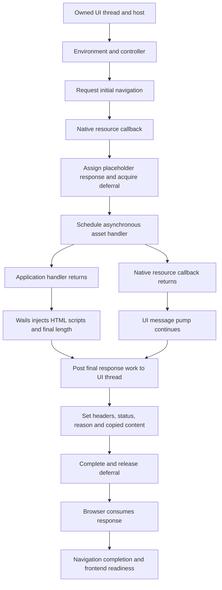

# Framework deconstruction and failure inventory

## 2026-10-19 source identities

Product baseline: S039 squash c9ed48d682e255f9e03f9d4ffd1ebbb9801f9c20, tree identical to accepted 8d2f1c7. Go 1.27.1, Wails v2.16.0, maintained go-webview2 v1.0.22. Current upstream baseline: authoritative v1.0.23, whose complete upstream delta is two BOOL wrappers, with the explicitly maintained response/window/callback corrections. Do not equate the loader's available runtime string with the created environment's identity.

## Responsibility map

| Stage | Source authority | Ownership and observed boundary |
| --- | --- | --- |
| Launch | internal/process/hide_windows.go:9-14; tree_windows.go:12-65 | Hidden suspended root, assigned owned job before resume. |
| COM/UI thread | edge/corewebview2.go:18-26; Wails internal/frontend/desktop/windows/winc/app.go:22-23 | Locked initialization/UI thread, STA apartment. |
| Host creation | Wails windows/frontend.go:161-184; window.go:50-152 | One owned native host; controller setup precedes normal main loop. |
| Environment | edge/chromium.go:126-182,281-304 | Default loader uses installed runtime; retained borrowed environment. |
| Controller | edge/chromium.go:306-377 | Retain controller, query Controller3, configure raw bounds and monitor scale, get WebView, register callbacks. |
| Active callbacks | edge/callback_bridge_windows.go:47-174; edge/create_env_go.go:11-35 | Native-allocated bridge, canonical identity and retained native targets; creator leases close after owned cleanup, canceled/late events do not reopen the owner. |
| Native BOOL defect | edge/ICoreWebView2Controller3.go:111-120 | v1.0.22 passes address of bool to BOOL-by-value setter. Initialization invokes false at chromium.go:333. Upstream v1.0.23 replaces it with 0/1. |
| Navigate | Wails windows/frontend.go:603-614; edge/chromium.go:225-234 | Register all-resource filter, request initial navigation; acceptance is not completion. |
| Deferred resource | Wails windows/frontend.go:635-690; pkg/assetserver/webview/request_windows.go:17-56 | On UI thread, create empty response, assign it, acquire deferral, snapshot metadata and dispatch asynchronous work. |
| Handler | Wails pkg/assetserver/assetserver_webview.go:26-58,65-149; app startup_diagnostics.go:25-40 | Middleware return is before HTML transformation and native Finish. |
| HTML | Wails pkg/assetserver/assetserver.go:140-172,187-220; common.go:45-55 | Inject IPC/runtime scripts and replace Content-Length with final byte length. |
| Publish | Wails pkg/assetserver/webview/responsewriter_windows.go:56-104 | UI invoke sets headers, status/reason and copied stream content. |
| Complete | Wails pkg/assetserver/webview/request_windows.go:123-141 | Release caller response reference, Complete deferral, release acquired deferral reference. |
| Ready | edge/chromium.go NavigationCompleted; Wails windows/frontend.go:952-1004 | Navigation callback starts OnDomReady, controller Hide/Show and application showing. Frontend listener is another readiness boundary. |
| Native input | cmd/insonic-desktop/exit_qualification_windows.go; native_menu_windows.go | Actual owned foreground target, original native key route, menu cancellation/focus restoration, reopen and callback. |
| Close | Wails internal/app/app_production.go:17-24; edge/window_lifetime_windows.go:535-565,609-644 | Loop exit followed by native parent destruction; subclass invokes Close once and releases retained interfaces before forwarding destruction. |
| Apartment | cmd/insonic-desktop/webview_lifetime_windows.go; edge/window_lifetime_windows.go:646-675 | Balance original thread's COM initialization after owned windows disappear. |
| Process group | internal/process/capture.go:73-85; descendants_windows.go:22-100 | After root exit, observe owned job active count and actual process handles; forced cleanup never passes. |

Wails paths above are relative to the exact pinned Wails v2.16.0 module; edge paths are relative to third_party/go-webview2/pkg/. This map is version-bound.

## Asynchronous document boundary

Handler return and native callback return are earlier than final response publication. A successful Complete is earlier than demonstrated browser consumption. S040 observes seven native response-call boundaries without adding WebView2 COM calls. The headers boundary is GetHeaders acquisition; individual AppendHeader writes remain unobserved. E006 adds unique all-response completion and runtime-ready counters.

## Retained signatures

| Signature | Established evidence | Current status/limit |
| --- | --- | --- |
| Controller creation | Earlier failure before native input, recovered HRESULT800700aa | Private runtime condition unproved. The upstream BOOL error is executed during controller completion, distinct from a failing CreateController result. |
| Pre-DOM | cold028 and final-head CI attempt1: navigation1/1, resource1/1, document1/1, scripts0/completion0, live Go UI pump | E003 observes successful first-response operations/Complete with6returned callbacks and no navigation completion; later responses remain unknown. E004 recurs before its optional diagnostic crash. None of the proven ABI/callback fixes fully explains the stall. |
| UI join | Earlier two-second owned-UI operation timeout | Not captured by cold028; do not conflate with its prepared window and idle GetMessage. |
| Menu consumption | Captured missing X despite visible popup; owned queue responded | Native focus correction has actual cancellation/reopen regressions and two 144-case samples. Historical browser internals unproved; retain those limits. |
| Browser release | Final-head CI attempt2: action passed, host exit0, two actual owned live WebView processes at deadline | Historical attempt lacks stage durations; S040 now observes original remaining budget on new cases. Close is not a full process-exit receipt. |

## Rejected or separated explanations

- Initial CSP is not applied to the initial document; help policy is path-specific.
- Final Content-Length is rewritten after framework HTML injection.
- Cold028 already mirrors startup-hide and reaches window-prepared; initial show/keyboard handling cannot explain that pre-DOM occurrence.
- Cold028 has no selected blocked Wails response-worker stack. This disfavors a stranded Invoke waiter for that captured instant; the existing four-stack cap still needs honest limit accounting when more stacks exist.
- Warm profiles are reused only after observed natural release. No evidence establishes profile overlap as the cause.
- The nonempty CreateWebResourceResponse stream-shadow defect is outside this Wails path, which initially passes nil content.
- Existing process observations inspect owned handles; they cannot be dismissed as ambient PID counts.
- Additional settings/controller query leaks are real independent source concerns. The9active callback QueryInterface/retention contracts are now corrected with the existing bridge, while unused legacy helpers remain upstream bytes. Explicit successful Close should release the WebView and event cycles; those concerns do not by themselves explain surviving browser processes.

## Experiment decision boundary

First prove/correct the native BOOL argument independently. Then observe the first unresolved response/release boundary in a bounded source experiment. If status/content/Complete succeed on the owning thread before a pre-DOM stall, move to browser consumption/runtime identity rather than adding another host response theory. If release fails, use stage timing and actual process roles before changing shutdown integration. Keep each result separate and retain every failed occurrence.

## E003 post-response deconstruction (2026-10-19)

The expected6initial resources are the document, Wails IPC/runtime scripts,2stylesheets and the deferred app bundle. Wails assetserver.go:127-136 serves the2runtime routes before product middleware; assetserver.go:200-205 and common.go:58-68,85-96 prepend classic IPC then runtime scripts. The observed middleware document1/script1/other2 and native6counts fit this set, but do not identify the5later response completions. A script handler return establishes neither script execution nor parsing completion.

Product desktop/index.html:7-12 supplies both stylesheets and the deferred bundle. main.tsx:10-24 starts React synchronously; its qualification IIFE at64-83 is unawaited. App.tsx effects issue bridge promises after render. Wails desktop runtime/main.js:49-100 initializes synchronously and sends runtime:ready at221; frontend.go:732-743 processes it without gating navigation. No initial API-fetch/top-level-await cycle was found. Native NavigationCompleted precedes Wails frontend.go:952-954 OnDomReady. A script exception alone would ordinarily prevent frontend readiness without itself preventing page load.

Thus E003 narrows the remaining alternatives to later native response completion, browser load progress and native navigation event delivery. The native callback contract correction is independently justified and is the next changed behavior. If failure persists afterward, observe all6initial responses and a fixed runtime-ready receipt rather than extrapolating from the first. [Primary navigation model](https://learn.microsoft.com/en-us/microsoft-edge/webview2/concepts/navigation-events), [NavigationCompleted](https://learn.microsoft.com/en-us/microsoft-edge/webview2/reference/win32/icorewebview2#add_navigationcompleted), [HTML script processing](https://html.spec.whatwg.org/multipage/scripting.html#the-script-element).

## Process model cross-check (2026-10-19)

Microsoft documents all WebView calls/callbacks on a pumped STA and serial callback delivery. Deferrals postpone event completion; missing Complete can block rendering. The retained idle GetMessage profiles differ from a host thread blocked waiting inside an event or synchronous UI join. This distinction is observational, not proof that the browser renderer is responsive. [Threading model](https://learn.microsoft.com/en-us/microsoft-edge/webview2/concepts/threading-model).

A user-data folder selects a browser process group, potentially including several renderers plus GPU/utility processes. Each fresh qualification profile requests a separate group. Native Close releases handler cycles and closes the control, while BrowserProcessExited is the explicit browser-resource release event. Existing owned-job observation still provides independent actual process-release evidence. A host exiting successfully and a synchronous Close result cannot replace that observation. [Process model](https://learn.microsoft.com/en-us/microsoft-edge/webview2/concepts/process-model), [controller Close](https://learn.microsoft.com/en-us/microsoft-edge/webview2/reference/win32/icorewebview2controller#close), [process events](https://learn.microsoft.com/en-us/microsoft-edge/webview2/concepts/process-related-events).

ProcessFailed covers crashes and unresponsive renderers, but the documented unresponsive notification can repeat on a roughly15-second interval. Absence of its log before the existing12-second watchdog cannot establish renderer health, and increasing that watchdog solely to await the notification is not elected. No browser/GPU failure or runtime regression has been demonstrated by E003/E004.

## E006 native-to-browser boundary (2026-10-19)

At child027, all5observed response/deferral paths finish and retire with no failures/overflow. The product app-script middleware stays0 and runtime-ready stays0. This is consistent with the document,2internally served Wails scripts and2stylesheets, but the existing counters do not identify each resource. Wails OnDomReady is derived from native NavigationCompleted, so its absence cannot independently establish that Chromium never parsed DOM. E007 will observe browser fetch completion, fixed response metadata, exceptions and page milestones before deciding which bootstrap line failed.

The concurrent audit finds no demonstrated cross-process environment or workspace collision. The Python parent freezes the child environment; CLI helpers copy it, and Go WEBVIEW2_* mutation is local to each GUI. Cold fixtures have no Workspace and do not join a CLI runtime endpoint. GUI profiles are unique cold-NNN/webview paths, retained through child observation and workload cleanup. Runtime IPC/locks include a canonical workspace hash and the Windows identity; ProcessTree jobs are unnamed per-launch handles. These facts disfavor a source-controlled global mutation, while shared CPU/memory/storage/OS/browser behavior remain unclassified. Nearly repeated failure ordinals27-29 require actual worker/phase timestamps before any workload attribution.

## Bootstrap dependency detail (2026-10-19)

| Boundary | Dependency and allowed inference | Remaining distinction |
| --- | --- | --- |
| Initial HTML | Wails parses and prepends classic IPC then runtime scripts before original head content. | A returned document/Complete does not prove Chromium consumed its stream. |
| IPC script | Finite platform lookup installs WailsInvoke from chrome.webview.postMessage. | Requested/returned content is not executed code. |
| Runtime script | Synchronous runtime/binding/listener initialization ends with WailsInvoke(runtime:ready). | No runtime-ready could be incomplete fetch, script exception/execution or message delivery. |
| CSS and app bundle | Original head has2stylesheets; body has deferred app.js. Browser speculative fetches can overlap parsing. | Do not infer a serialized fetch order from aggregate counts. |
| App bootstrap | main.tsx starts React, installs the qualification listener and starts an unawaited bridge IIFE. | Bridge promises do not create a discovered top-level-await load cycle. |
| Actual DOM milestone | Chromium DOMContentLoaded follows parsing and deferred script execution. | Wails OnDomReady is a different callback. |
| Native navigation completion | WebView2 fires after load or a stopped navigation error; Wails forwards to OnDomReady. | Callback arrival alone is not successful app initialization. |
| Frontend-ready qualification | Native code separately waits for the actual app menu listener before native actions. | A ready JSON/action still does not prove natural owned-browser release. |

The selected CDP lifecycle event must match the initial document loader/frame; about:blank and unassociated page milestones cannot qualify application DOM/load. Network encoded transfer length is not a body-size receipt. Exact numeric Content-Length comparisons require complete observed decoded data and known identity encoding.

## E007 script-body completion boundary (2026-10-20 UTC)

All6initialresources reach Chromium with expected200/MIME/fullbodycounts, but runtime and app-script do not report loadingFinished. The other4finish. NoassociatedDOM/load, runtime-ready or nativeNavigationCompleted isobserved. At the firstfailure, actualconcurrentwork transitions from parallel-regressions to mainmedia-lifecycle; no CPU/memorymeasurement or exactparallelworkerposition is available.

The official Chromium mirror tag131.0.6778.86 is a major-version comparison, not the private Edge131.0.2903.86 source identity. script_streamer.cc (blob46b32fe6c7e82982529427ac2365456e9ee95737):854-870 forwards initialdata on the renderer mainthread then hands the pipe to streaming;749-758 posts a USER_BLOCKING/MayBlock task;546-581 runs V8, drainsremainingpipe and finishesdecoder;511-519 and898-952 defer clientbody-finish until completion reaches the mainthread. resource_loader.cc (bloba9343a658ec510c8edb356ec51cd1a335324113b):1161-1173 defers loaderfinish until body-finish. Therefore missingloadingFinished with fullinitialdata does not identify nativeIStream EOF or a JavaScript exception. Backgroundtask scheduling/execution, pipeEOF, decoder and completiondelivery remain distinct. No productionfeatureflag/priority/runtime change is selected by this source correspondence alone. [Pinned script source](https://github.com/chromium/chromium/blob/131.0.6778.86/third_party/blink/renderer/bindings/core/v8/script_streamer.cc), [pinned loader source](https://github.com/chromium/chromium/blob/131.0.6778.86/third_party/blink/renderer/platform/loader/fetch/resource_loader.cc).

The alternate BackgroundResourceScriptStreamer path orders parsing/decoding before forwarding buffered body data (script_streamer.cc:1733-1753, background_url_loader.cc:369-383/569-585); E007 does not distinguish it from the foreground path. InspectorNetworkAgent may emit a zero-byte data event when flushing encoded length, so data-event count is not a count of native stream reads. The only two unfinished bodies also exceed16KiB; retain this size/class confound until E008 supplies its comparison.

## Additional upstream bootstrap-race cross-check (2026-10-20 UTC)

Current Microsoftfeedbackreport [5716](https://github.com/MicrosoftEdge/WebView2Feedback/issues/5716) describes delayed document-created script registration racing firstnavigation; it is an unconfirmed external report, not an identified cause here. Pinned go-webview2 chromium.go:182/252-257 calls AddScriptToExecuteOnDocumentCreated without observing completion. Microsoft's [APIcontract](https://learn.microsoft.com/en-us/microsoft-edge/webview2/reference/win32/icorewebview2#addscripttoexecuteondocumentcreated) distinguishes asynchronous registration completion from initiation. However, the actual Wailsv2.16.0 ipc.js directly uses window.chrome.webview.postMessage to install WailsInvoke and does not require the registered window.external shim. Runtime-ready is sent through that directIPC at the end of runtime_prod_desktop.js. E008 receives runtime-ready1 with no associatedDOM/load, so a missing externalshim does not explain its recorded boundary. E007's missing runtime/app loadingFinished also does not establish shim absence. No new registration gate, retry or production change is selected from this report.

## Process priority and the earlier CDP gate (2026-10-20 UTC)

E010 establishes a timely 12.003474-second watchdog but a pending diagnostic Network.enable acknowledgement before navigation. Its live job has 7 BelowNormal, 1 Idle and 1 AboveNormal process classes, without role mapping; neither a renderer role nor the GUI host's class can be inferred from those PIDs. A priority class combines with relative thread priority and dynamic boosts; blocked threads do not become runnable merely from higher priority. [Scheduling](https://learn.microsoft.com/en-us/windows/win32/procthread/scheduling-priorities), [waiting versus ready](https://learn.microsoft.com/en-us/windows/win32/procthread/context-switches), [dynamic boosts](https://learn.microsoft.com/en-us/windows/win32/procthread/priority-boosts).

Actual creation paths omit priority flags, allowing BelowNormal/Idle inheritance; project-owned jobs set no priority policy. A control must change only actual GUI creation and verify the resulting effective class. Changing the entire job or serializing all workload would answer broader questions. E011 is diagnostic only; normal foreground priority is not silently promoted into a new product eligibility rule or an accepted explanation of the original failure.

## Scheduling guidance cross-check (2026-10-20 UTC)

Microsoft's [WebView2 performance guidance](https://learn.microsoft.com/en-us/microsoft-edge/webview2/concepts/performance) explicitly identifies heavy native work and thread-priority choices as a possible way to deprive the separate WebView renderer processes of execution. This supports investigating the measured contention; it does not identify the cause of this incident or validate a process-priority repair. Current experimental timer-throttling documentation defines foreground by controller IsVisible, even when occluded, but targets a newer runtime contract than incident131. No hidden-window throttling flag, timer API or GPU policy change is selected from that newer material.

The old runner-images report [7663](https://github.com/actions/runner-images/issues/7663) describes BelowNormal Windows step inheritance in2023, but is not current-cause evidence. E010 reports runner2.337.0. Its exact tagged [ProcessInvoker.cs](https://github.com/actions/runner/blob/v2.337.0/src/Runner.Sdk/ProcessInvoker.cs#L526-L548) calls DecreaseProcessPriority, whose body is Linux-only and contains no Windows priority write. Therefore the tempting claim that this current runner method lowered the Windows step is unsupported. Ancestor/service/image context or another setter remains unresolved. E011's actual wrapper receipt, not that historical report, determines whether its contrast is available.
